# Quant Lab

[](https://github.com/adityarjain/quant-portfolio-lab/actions/workflows/tests.yml)

*Momentum, pairs trading, mean-variance optimization and Monte Carlo risk on US large caps, 2010–2026, with a strict train/test split, T-bill excess returns, significance tests and backtested VaR.*

## Abstract
We build two classic anomaly strategies, combine them with mean-variance optimization, and stress-test the result. Everything is fit on 2010–2018 and evaluated once on 2019–2026, net of 10 bps per unit of turnover, with Sharpe ratios measured in excess of 3-month T-bills. **No strategy beat a passive benchmark out of sample.** Cross-sectional 12-1 momentum earned a net Sharpe of 0.74 against 0.80 for an equal-weight portfolio of the same 48 stocks. The pairs screen found 6 cointegrated pairs out of 120, exactly the number chance predicts, and none stayed cointegrated after 2018 (test Sharpe 0.17). Mean-variance optimization put 0% in momentum, let a hand-set 40% cap decide the allocation, and lost to a naive 25%-each mix (0.52 vs 0.76): the two streams it favoured, pairs and bonds, collapsed out of sample. **Significance tests then show that none of these comparisons is statistically distinguishable from luck**: every 95% Sharpe interval spans roughly ±0.7, and every head-to-head difference has p ≥ 0.17. On risk, a static normal or historical VaR fit on the calm 2011–2018 period broke 2–6x too often after 2018. Rescaling the historical tail by current EWMA volatility (filtered historical simulation) **passes the Kupiec coverage test for all three portfolios at both 95% and 99%**. A six-factor regression (Fama-French 5 + momentum) finds **no significant alpha in any strategy out of sample**; momentum is a 0.97-beta market position with a modest momentum tilt. Estimators built to resist estimation error don't rescue the optimizer: Ledoit-Wolf and Bayes-Stein shrinkage leave its weights unchanged, and risk parity does worse still (0.38), because the problem was a regime change, not noisy estimates. Re-running the whole design at 13 yearly cutoffs (2014–2026, everything re-fit on prior data only) turns one 7.8-year test into a 12.8-year out-of-sample record: confidence intervals shrink by about a quarter, the pairs book's Sharpe falls to 0.01, and still no difference between strategies is significant. Transplanted to 48 Indian large caps (Indian costs, Indian short rate), the design fails the same way: momentum's in-sample Sharpe of 1.18 falls to 0.35, and pairs that stay cointegrated still lose money after Indian costs. The project's only statistically significant result, equal-weight beating the Nifty ETF (p = 0.02), turns out to be survivorship bias: rebuilt on the Nifty 50's actual point-in-time membership, the gap shrinks to p = 0.09, while hindsight in the universe is worth a significant 8.6% a year in train and explains half of Indian momentum's in-sample return. The lesson is about process: in-sample numbers were convincing everywhere, and only an out-of-sample split, honest costs and formal inference exposed which ones were real.

## Hypothesis
Momentum and pairs trading are among the most documented anomalies in equities. We test whether they survive realistic transaction costs **out-of-sample**, and whether combining them with mean-variance optimization improves risk-adjusted returns and tail risk versus any single strategy or buy-and-hold.

## Verdict (test period 2019-01-02 → 2026-10-06, net of costs, Sharpe over T-bills)
| strategy | Sharpe (net) | CAGR (net) | vol | maxDD | turnover/yr |
|---|---|---|---|---|---|
| Buy & hold SPY | 0.80 | 17.6% | 19.2% | -33.7% | 0.00 |
| Equal-weight 48 | 0.80 | 16.8% | 18.1% | -36.2% | 0.00 |
| XS momentum 12-1 | 0.74 | 18.1% | 22.1% | -30.3% | 5.40 |
| MA 50/200 on SPY | 0.59 | 11.6% | 16.1% | -33.7% | 0.90 |
| Pairs portfolio (5) | 0.17 | 3.6% | 5.7% | -10.6% | 9.27 |
| Max-Sharpe (train fit) | 0.52 | 5.7% | 5.7% | -11.3% | 0.00 |
| Walk-forward max-Sharpe | 0.65 | 8.6% | 9.1% | -12.1% | 0.88 |
| Equal-weight 4 | 0.76 | 10.6% | 10.4% | -17.9% | 0.00 |

| Hypothesis | Answer |
|---|---|
| Momentum survives costs out of sample | **Partly.** Costs are small (~0.03 Sharpe), but the signal doesn't beat its own equal-weight universe. |
| Pairs trading survives costs out of sample | **No.** The cointegration found in train was chance-level and vanished; costs took 29–48% of what remained. |
| Optimizing the combination beats naive mixing | **No** on Sharpe (0.52 vs 0.76). **Yes** on drawdown (−11.3% vs −17.9%), at the price of much lower return. |
| Any of these Sharpe differences is real | **Not shown.** With 7.8 years of test data, no difference is significant (p = 0.17–0.89, M8). |
| Tail risk is captured by a static model | **No.** Every static VaR fails its backtest (M4, M9). |
| A volatility-adjusted VaR fixes that | **Yes.** EWMA-filtered historical VaR passes Kupiec at 95% and 99% for all three portfolios (M9). |
| Any strategy has alpha beyond known factors | **No.** Largest test-period \|t(alpha)\| is 0.92 (M11). The only significant alpha (pairs, train, t = 2.1) is in-sample. |
| Robust estimators fix the optimizer | **No.** Shrinkage leaves the weights unchanged; risk parity does worse (0.38 vs 0.76, M12). |
| The conclusions transfer to India | **Yes, and the problems get worse.** Higher costs and a 5–7% short-rate hurdle; in-sample momentum collapses out of sample (M14). |
| Survivorship bias drives the India results | **Yes.** With point-in-time Nifty 50 membership, EW vs the index is no longer significant (p = 0.09) and in-sample momentum drops from 28.3% to 13.0% a year (M15). |
| The conclusions survive other cutoffs | **Yes, and still none is significant.** Over 13 yearly out-of-sample periods the ranking holds; the differences shrink (p = 0.27–0.66, M13). |

Generated by `run.py` as `figures/summary.md`.

## Data
| | |
|---|---|
| Source | Yahoo Finance via `yfinance`, adjusted close (splits + dividends) |
| Universe | 48 US large caps (8 sectors × 6) + SPY (equity benchmark) + BND (bonds) |
| Risk-free | 3-month T-bill (FRED `DTB3`), forward-filled to trading days, ÷ 252 per day. Averaged 0.40% p.a. in train, 2.75% in test (peak 5.36%, Oct 2023) |
| Factors | Fama-French 5 + momentum, daily (Kenneth French data library), cached in `data/ff.parquet`. Ends 2026-08-31, so factor regressions cover the test period to that date (1,926 days) |
| India (M14) | 48 NSE large caps (8 sectors × 6) + NIFTYBEES (Nifty 50 ETF) + GOLDBEES (gold ETF, in the bond slot), 2010-02-01 → 2026-10-23, `data/prices_in.parquet`; short rate = India interbank call money (OECD/FRED `IRSTCI01INM156N`, monthly): 7.45% p.a. in train, 5.62% in test |
| India point-in-time (M15) | Nifty 50 membership on every date 2010–2026, rebuilt from today's list by undoing the 51 index changes in Wikipedia's NIFTY 50 change log (which cites NSE press releases), `data/nifty50_membership.csv`; prices for all 96 tickers ever in the index, `data/prices_pit.parquet`; 95.4% of member-days have prices |
| Period | 2010-01-04 → 2026-10-06 (download dates in `data/meta.json`, `data/meta_rf.json`, `data/meta_ff.json`) |
| Train | 2010-01-04 → 2018-12-31 (2,264 days): all parameters, pair selection, hedge ratios and optimizer weights fit here |
| Test | 2019-01-02 → 2026-10-06 (1,951 days): evaluated once, never tuned on |

**Cleaning.** Gaps of at most 2 trading days are forward-filled (never back-filled, so no future prices leak in); any ticker with a longer gap or missing early history is dropped. All 50 tickers passed. Daily moves above 30% were checked by hand and are real events (OXY/EOG on the 2020-03-09 oil crash, ORCL on 2025-09-10).

**Reproducibility.** Prices, T-bill rates and factors are cached in `data/prices.parquet`, `data/rf.parquet` and `data/ff.parquet` and committed, so results do not change when the sources revise history. `python data.py --refresh` re-downloads prices.

## Method

### Backtest engine (`backtest.py`)
Every strategy outputs target weights $w_{i,t}$ decided at the close of day $t$. The engine is the only place P&L is computed:

$$r^{gross}_t = \sum_i w_{i,t-1}\, r_{i,t} + \Big(1 - \sum_i \max(w_{i,t-1}, 0)\Big)\, r^f_t, \qquad \tau_t = \sum_i |w_{i,t-1} - w_{i,t-2}|, \qquad r^{net}_t = r^{gross}_t - c\,\tau_t$$

with $c$ = 10 bps per unit of turnover. Capital not used to fund long positions earns the T-bill rate $r^f_t$ (the yield known at the previous close); short-sale proceeds earn nothing, the conservative case. The one-day lag means no signal earns the return of the day it was computed on; `tests.py` proves this by feeding the engine a cheating signal ($\text{sign}(r_t)$, Sharpe > 10 if applied same-day) and asserting it earns nothing. Every Sharpe ratio is annualized on **excess** returns, $\sqrt{252}\,\overline{(r - r^f)} / \sigma(r - r^f)$.

### M1 · Momentum (`momentum.py`)
Parameters are textbook defaults, **not tuned**, so there is nothing to overfit in train.

- **Cross-sectional 12-1** (Jegadeesh & Titman, 1993). At each month end, score each of the 48 stocks by $\;p_{t-21}/p_{t-252} - 1$ (12-month return skipping the last month, which tends to reverse). Hold the top quintile (10 stocks) equal-weighted until the next month end. Long-only.
- **Time-series 50/200 MA on SPY.** 100% SPY while $\text{SMA}_{50} > \text{SMA}_{200}$, else T-bills.
- **Benchmarks.** Buy-and-hold SPY, and equal-weight across the same 48 stocks. The second one is the fair benchmark for cross-sectional momentum: same universe, so any difference is due to stock selection alone.

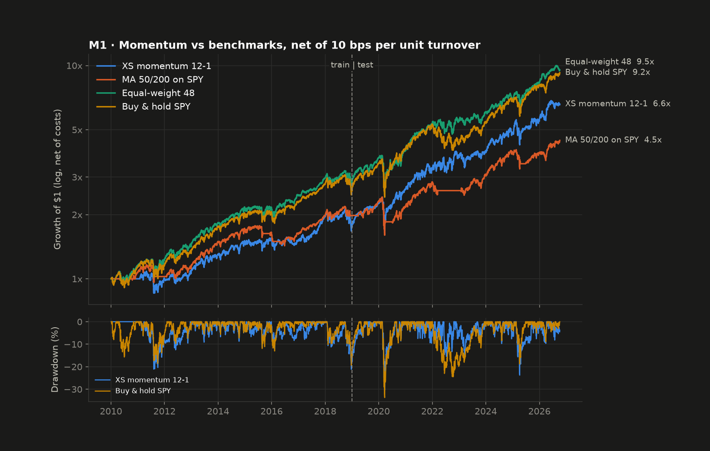

### M2 · Mean-reversion pairs (`pairs.py`)
**Correlation is not cointegration.** Correlation measures whether two stocks' *daily returns* move together; cointegration asks whether a combination of their *price levels* is stationary, i.e. whether the gap between them is pulled back toward a mean. Only the second justifies betting on the gap closing. Two stocks can be 0.8 correlated day to day and still drift apart forever.

1. **Scan (train only).** All 120 within-sector pairs (8 sectors × C(6,2)). For each: return correlation, Engle-Granger p-value on log prices (H₀: no cointegration), OLS hedge ratio, and half-life of mean reversion.
2. **Select.** The 5 lowest p-values with $p < 0.05$ and $\beta > 0$.
3. **Hedge ratio** from OLS on train, frozen for test: $\log A_t = \alpha + \beta \log B_t + \varepsilon_t$.
4. **Signal.** Spread $s_t = \log A_t - \beta \log B_t$, rolling z-score $z_t = (s_t - \bar s_{60}) / \sigma_{60}$.
5. **Rules.** Short the spread at $z > 2$, buy it at $z < -2$; exit when $z$ crosses back inside ±0.5; stop out at $|z| > 4$ and stay flat until $z$ returns inside ±0.5. Each pair has gross exposure 1 (long $\tfrac{1}{1+\beta}$ of one leg, short $\tfrac{\beta}{1+\beta}$ of the other); the portfolio splits capital equally across the 5 pairs. Capital not funding the long leg earns T-bills.
6. **Half-life.** From $\Delta s_t = k\, s_{t-1} + c$: $\;t_{1/2} = -\ln 2 / k$.

Rules (2, 0.5, 4, 60-day window) are common textbook values, not tuned. Train results are in-sample by construction (pairs and β were chosen on that data); test is the honest number.

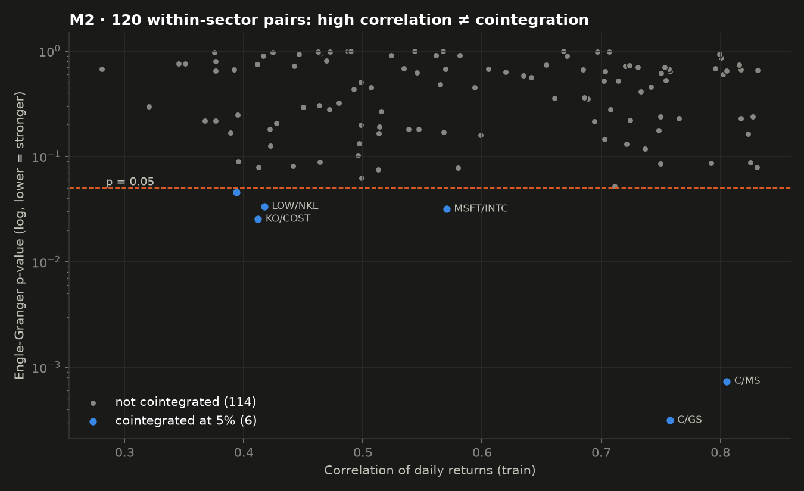
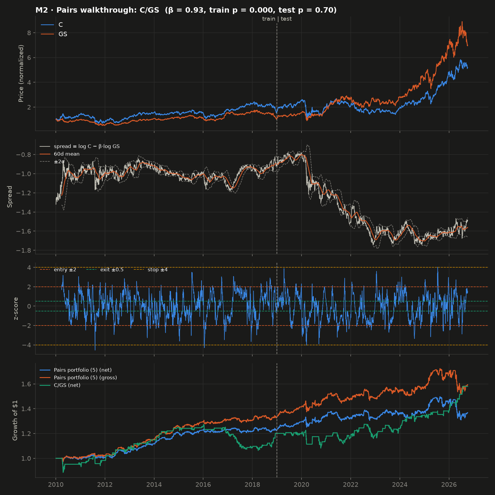

### M3 · Efficient frontier (`frontier.py`)
Markowitz mean-variance on daily train **excess** returns, so max Sharpe is the tangency portfolio against T-bills:

$$\max_w \frac{w^\top \mu^{ex}}{\sqrt{w^\top \Sigma w}} \quad\text{(max Sharpe)}, \qquad \min_w w^\top \Sigma w \;\text{ s.t. }\; w^\top\mu^{ex} = r^\* \quad\text{(frontier)}$$

$$\text{subject to}\quad \textstyle\sum_i w_i = 1,\quad 0 \le w_i \le 0.4$$

Solved with `scipy.optimize.minimize` (SLSQP). The 40% cap stops the optimizer from putting everything in one asset. 10,000 random long-only portfolios (Dirichlet(1), same cap) show the feasible cloud; the frontier is its upper-left edge. The capital market line runs from the T-bill origin through the max-Sharpe point.

Two universes:
- **M3a · raw assets.** 8 equal-weight sector baskets + BND.
- **M3b · the integration step.** The *net* daily return streams of M1 momentum and the M2 pairs portfolio, plus SPY and BND. Each strategy is treated as an asset. Streams start when momentum goes live (Feb 2011).

Out-of-sample allocation, all run through the same engine (each stream's equity curve is an asset, so rebalancing is charged at 10 bps):
- **Max-Sharpe (train fit)**: weights fit on 2011–2018, then frozen through 2026.
- **Walk-forward max-Sharpe**: re-fit every quarter end on the trailing 756 days (3 years) only. This is a real-time version with no look-ahead.
- **Equal-weight 4** (25% each) and **SPY** as naive benchmarks.

Walk-forward needs 3 years of history, so all four allocations are compared from April 2014.

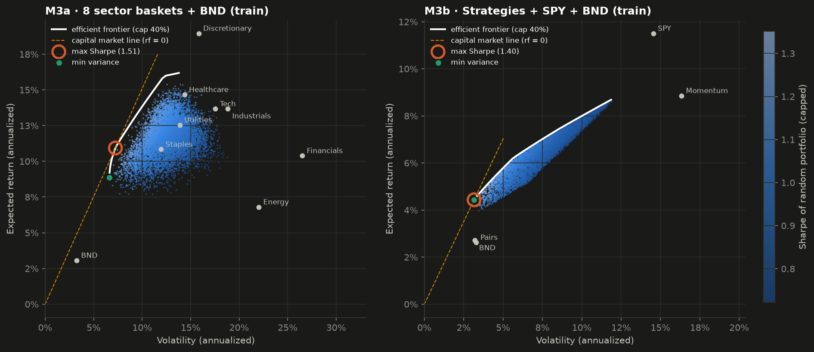
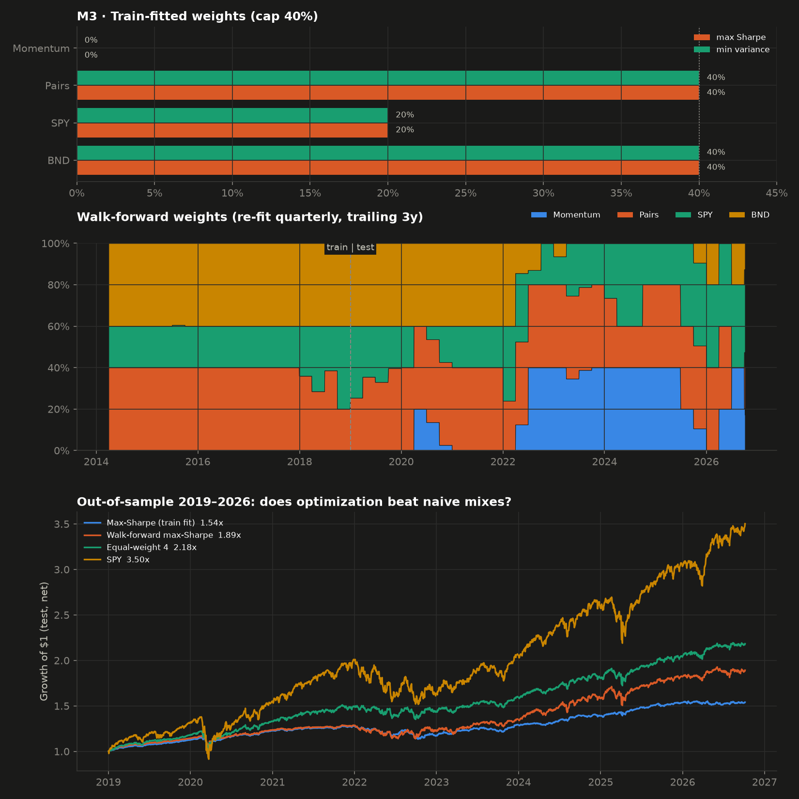

### M4 · Monte Carlo risk (`montecarlo.py`)
The question is no longer "what did happen" but "what *could* happen", and how much that answer depends on the model. Three portfolios: the M3 max-Sharpe allocation, equal-weight 4, and SPY. For each, daily portfolio returns over **train** feed two models, and 10,000 paths of 5 years (1,260 days) are simulated with a fixed seed.

- **A · Normal.** $r_t \sim \mathcal N(\hat\mu, \hat\sigma^2)$ i.i.d. For fixed weights, this is exactly the multivariate normal of the four streams projected onto $w$: $w^\top r \sim \mathcal N(w^\top\mu,\, w^\top\Sigma w)$.
- **B · Block bootstrap.** Each path chains randomly chosen 21-day windows of real train history. It keeps what the normal model discards: fat tails, skew, cross-asset co-movement on bad days, and short-run volatility clustering.

Risk measures, reported as positive losses:

$$\text{VaR}_\alpha = -Q_{1-\alpha}(r), \qquad \text{CVaR}_\alpha = -\mathbb E\left[r \mid r \le Q_{1-\alpha}(r)\right]$$

VaR is the loss exceeded on the worst $1-\alpha$ of days; CVaR (expected shortfall) is the *average* loss on those days. We also report 1-month (21-day) VaR/CVaR, the 5/50/95th percentiles of the 5-year return, the probability of a 5-year loss, and the distribution of each path's maximum drawdown.

**Backtesting the risk model.** A VaR is a forecast, so it can be checked. Each model's 1-day VaR (fit on train) is compared with realized test-period returns. A calibrated 95% VaR should be breached on about 5% of days, and a 99% VaR on about 1%.

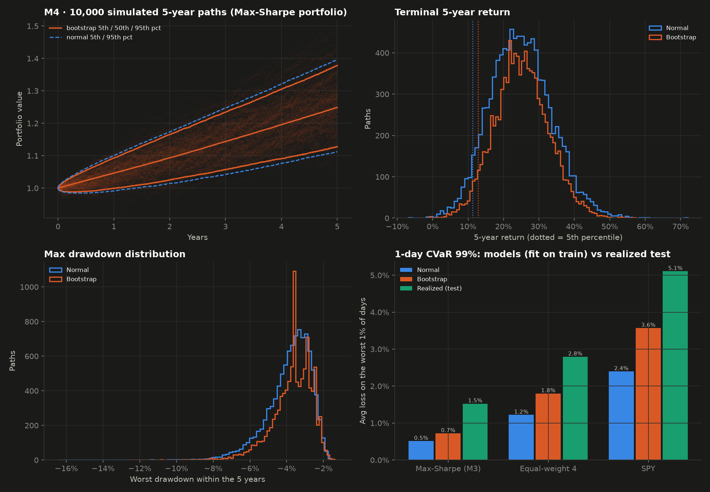

### M8 · Is any of this significant? (`significance.py`)
A Sharpe ratio estimated from 7.8 years of daily data has a standard error of roughly $\sqrt{1/7.8} \approx 0.36$, about the size of every gap in the verdict table. All inference is on daily net returns in excess of T-bills over the test period:

- **Confidence intervals.** 5,000 moving-block bootstrap resamples (21-day blocks keep autocorrelation and volatility clustering); 95% percentile interval.
- **Differences.** For "is A's Sharpe higher than B's?", both series are resampled on the *same* bootstrap dates, so their correlation is preserved (the approach recommended by Ledoit & Wolf, 2008). Two-sided p-value for $H_0$: equal Sharpe.
- **Probabilistic Sharpe Ratio** (Bailey & López de Prado, 2012), using per-period $\widehat{SR}$, skew $\gamma_3$ and kurtosis $\gamma_4$:

$$\text{PSR}(SR^\*) = \Phi\!\left(\frac{(\widehat{SR} - SR^\*)\sqrt{T-1}}{\sqrt{1 - \gamma_3 \widehat{SR} + \frac{\gamma_4 - 1}{4}\widehat{SR}^2}}\right)$$

- **Deflated Sharpe Ratio** (Bailey & López de Prado, 2014): PSR against the Sharpe that the *best* of $N$ strategies would reach by luck if all were truly zero,

$$SR_0 = \sqrt{\mathbb V[\widehat{SR}_k]}\,\Big((1-\gamma)\,\Phi^{-1}\big(1 - \tfrac1N\big) + \gamma\,\Phi^{-1}\big(1 - \tfrac{1}{Ne}\big)\Big), \qquad \gamma \approx 0.5772$$

with $N = 8$, the strategies in the verdict table.

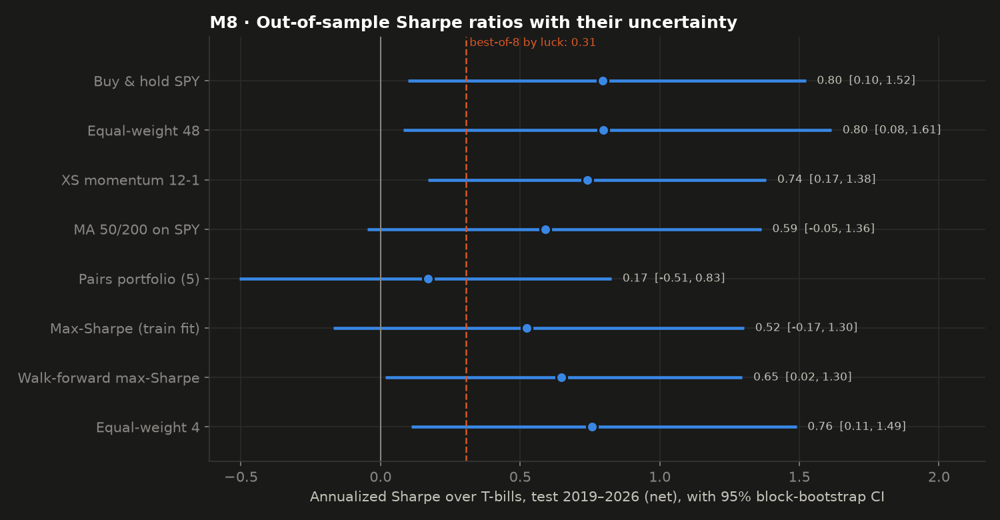

### M9 · VaR that adapts to volatility (`montecarlo.py`)
M4's static models failed because volatility after 2018 was 30–90% higher than in train. M9 lets the VaR move with volatility, using the RiskMetrics EWMA forecast (λ = 0.94, the industry default, not tuned), which only uses returns up to the previous day:

$$\sigma^2_t = \lambda\,\sigma^2_{t-1} + (1-\lambda)\,r^2_{t-1}$$

Four 1-day VaR models, all with parameters from train:

| model | VaR$_t$ |
|---|---|
| Static normal | $-(\hat\mu + \hat\sigma\,\Phi^{-1}(1-\alpha))$ |
| Static historical | $-Q_{1-\alpha}(r^{train})$ |
| EWMA normal | $-\sigma_t\,\Phi^{-1}(1-\alpha)$ |
| EWMA filtered historical | $-\sigma_t\,Q_{1-\alpha}(r^{train}_s / \sigma_s)$, today's volatility × train's standardized tail shape (Hull & White, 1998) |

Each is backtested on 2019–2026 with **Kupiec's** proportion-of-failures test (is the breach rate right?) and **Christoffersen's** independence test (do breaches cluster?). Both are likelihood-ratio tests, $\chi^2(1)$ under $H_0$; a p-value below 0.05 rejects the model.

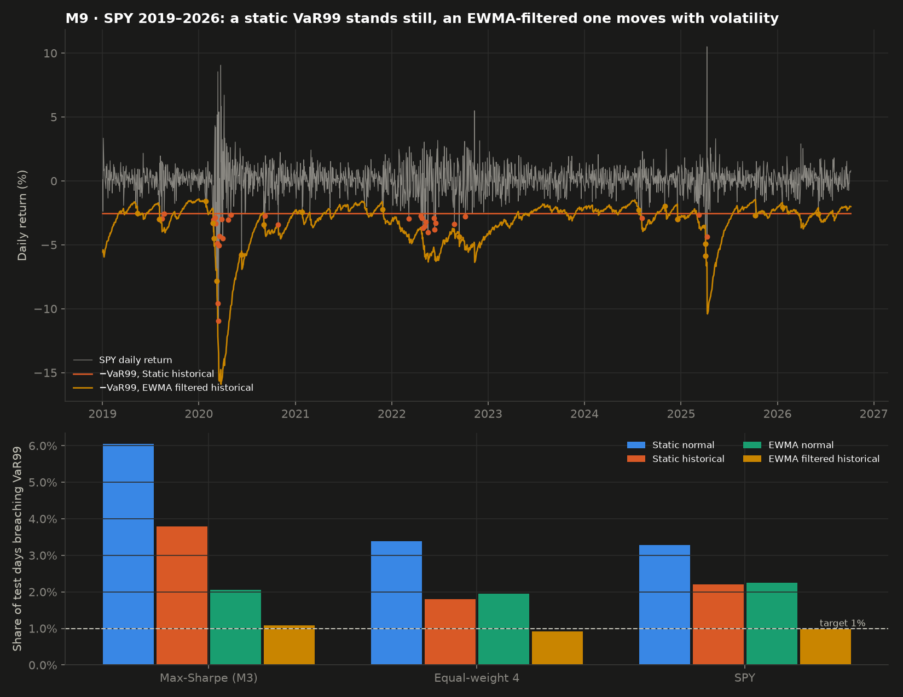

### M11 · Factor attribution (`factors.py`)
A Sharpe ratio says how much return per unit of risk; it doesn't say whether the return came from somewhere a cheap index fund already offers. Each strategy's daily net excess return is regressed on the six standard equity factors:

$$r_t - r^f_t = \alpha + \beta_{mkt}\,(\text{Mkt}-r^f) + \beta_{smb}\,\text{SMB} + \beta_{hml}\,\text{HML} + \beta_{rmw}\,\text{RMW} + \beta_{cma}\,\text{CMA} + \beta_{mom}\,\text{MOM} + \varepsilon_t$$

market, size, value, profitability, investment (Fama & French, 2015) and momentum (Carhart, 1997). $\alpha$ is the return none of them explain, annualized. Standard errors are Newey-West (HAC) with the plug-in lag $\lfloor 4(T/100)^{2/9} \rfloor$ (6–8 days for these samples), because daily strategy returns are autocorrelated and heteroskedastic. The SPY regression is the sanity check: it should show $\beta_{mkt} \approx 1$, $\alpha \approx 0$, $R^2 \approx 1$.

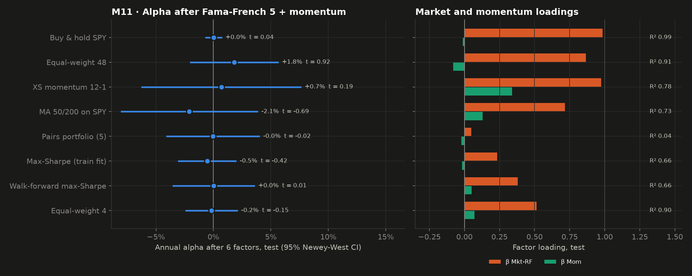

### M12 · Allocation that survives estimation error (`frontier.py`)
M3's optimizer lost to 1/N. The standard remedies target estimation error, so M12 tests them on the same four streams, fit on train and frozen:

- **Ledoit-Wolf covariance** (Ledoit & Wolf, 2004): $\hat\Sigma = \delta\,\bar\sigma^2 I + (1-\delta)\,S$, with the shrinkage intensity $\delta$ chosen analytically to minimize expected error.
- **Bayes-Stein means** (Jorion, 1986): $\hat\mu = (1-\phi)\,\bar\mu + \phi\,\mu_0\mathbf 1$, shrinking every asset's mean toward that of the minimum-variance portfolio, with $\phi = \frac{p+2}{(p+2) + T(\bar\mu - \mu_0\mathbf 1)^\top S^{-1}(\bar\mu - \mu_0\mathbf 1)}$.
- **Max-Sharpe** with both, and **min-variance** with Ledoit-Wolf (no $\mu$ needed), under the same 40% cap.
- **Risk parity** (equal risk contribution): weights such that every stream contributes the same share of portfolio variance, $w_i(\Sigma w)_i = \tfrac1p\, w^\top\Sigma w$. It needs no return forecast at all. Solved by cyclical coordinate descent on the convex problem $\min_w \tfrac12 w^\top\Sigma w - \tfrac1p\sum_i \ln w_i$ (Griveau-Billion, Richard & Roncalli, 2013). Also run walk-forward (re-fit quarterly on 3 trailing years).

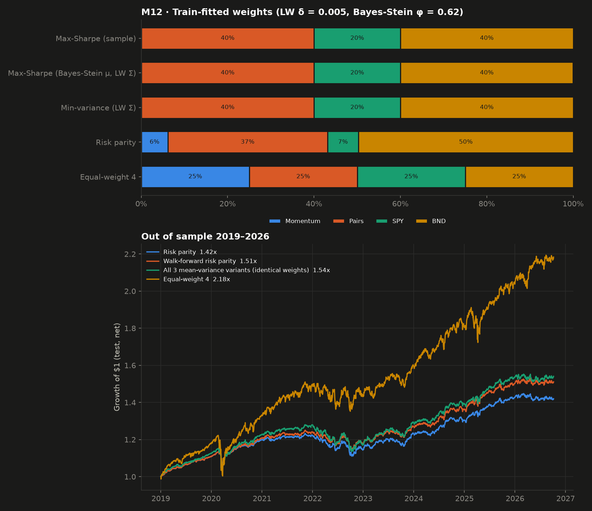

### M13 · Many out-of-sample periods (`walkforward.py`)
A single 2019 cutoff is one draw of history. M13 re-runs the design at **every** year boundary from 2014 to 2026. For test year $Y$:

1. Pairs are re-scanned and re-selected, and hedge ratios re-fit, on all prices before $Y$-01-01 (anchored, expanding window).
2. The max-Sharpe weights are re-fit on the strategy streams before $Y$-01-01.
3. That fit trades year $Y$ only. Momentum, MA 50/200, equal-weight 48 and SPY have no fitted parameters, so they are the same series sliced by year.

The 13 test years are then stitched into one record from 2014-01-02 to 2026-10-06, **12.8 years, every day out of sample relative to its own fit**, and passed through the M8 machinery. `tests.py` checks two things: at the 2019 cutoff the re-fit reproduces the main study's pairs and weights exactly, and reversing every price after a cutoff leaves the fit unchanged. The first test year is 2014, the first with four years of training data. The turnover of switching pairs or weights at a year boundary is not charged; it is about one unit of capital a year, roughly 10 bps.

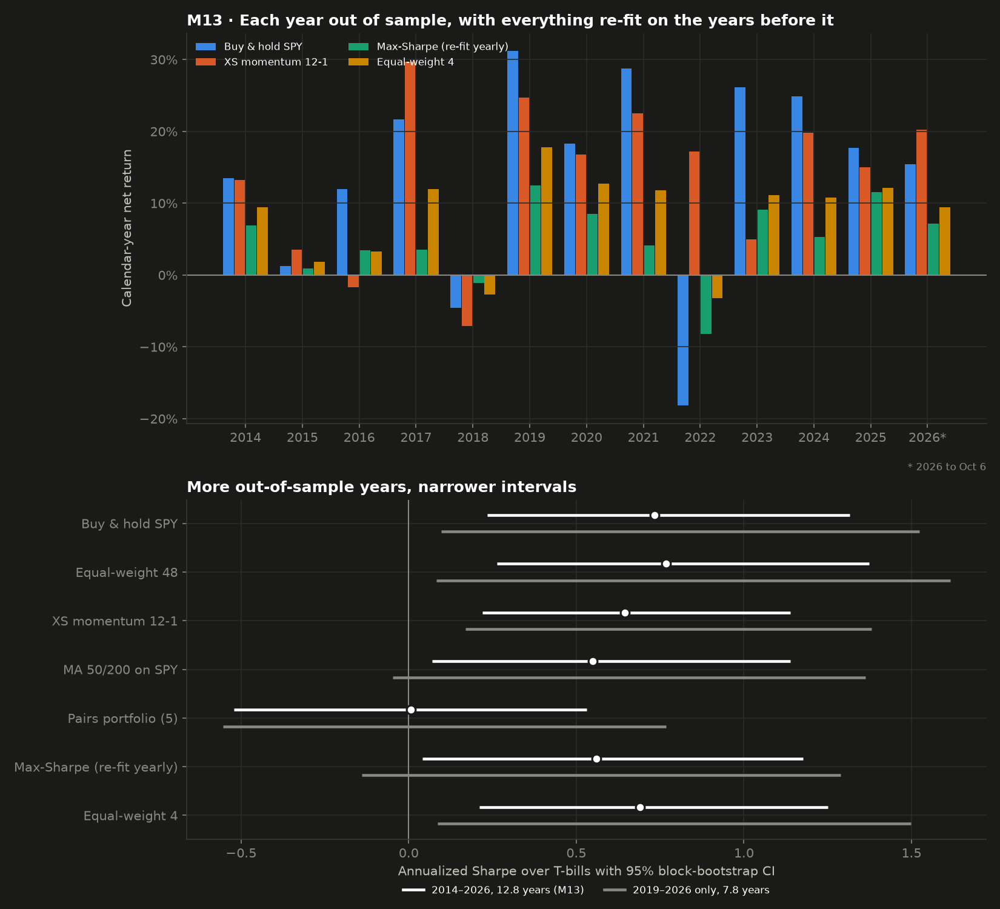

### M14 · Does it transfer? India (`data.py`, `run.py`)
The same M1–M3 design, unchanged, on an Indian universe built the same way: 8 sectors × 6 NSE large caps listed before 2010, same train/test split, same textbook parameters. Four things are different, all on purpose:

- **Costs: 20 bps per unit of turnover** (US: 10). Indian delivery trades pay securities transaction tax of 0.1% on *both* the buy and the sell, plus 0.015% stamp duty on buys and small exchange, SEBI and GST charges: about 11 bps statutory per side, plus about 9 bps of spread and impact. A sweep from 0 to 60 bps shows how much the conclusions depend on this number.
- **Short rate: India's interbank call-money rate** (7.45% in train, 5.62% in test, against US T-bills at 0.40% and 2.75%). The bar every strategy must clear is far higher. It's an overnight rate, the standard proxy where no long 91-day T-bill series is freely available.
- **Short selling.** Retail investors in India can't hold a short stock position overnight in the cash market; a short leg has to be a single-stock future. Every name in the universe has NSE stock futures, so the pairs design is implementable, with the same cost applied to both legs (futures pay lower STT but must be rolled monthly).
- **Data repair.** Yahoo's NSE data needed fixing where the US data didn't. GOLDBEES and NIFTYBEES printed at 1/100 and 1/10 of their price for two days in December 2019. A spike filter removes moves of more than 3x that snap back within 5 days (it removed exactly those 4 prints); real crashes don't snap back and are kept. GRASIM had no history, and Vedanta's 2026 demerger printed as a −65% day, so both were replaced (by Ambuja Cements and SAIL). The sample starts 2010-02-01 because some January-2010 prints are stale. Every remaining move above 12% was checked against a real event (COVID, the 4 June 2024 election result, fuel-subsidy shocks to oil marketers).

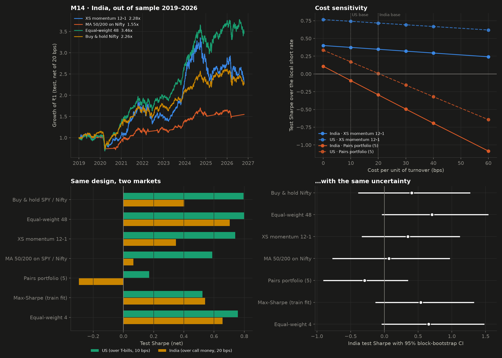

### M15 · India without hindsight (`survivorship.py`)
M14's universe was *today's* Indian large caps. A list drawn up in 2026 knows which companies grew, which shrank, and which disappeared, and a backtest on it inherits that knowledge. M15 replaces it with the universe an investor could actually have known about: **the Nifty 50 as it stood on each date.**

1. **Membership.** Start from today's 50 constituents and undo every index change since 2010 in reverse: put the excluded name back in, take the included one out. This is self-checking. The reconstruction must have exactly 50 members after every one of the 51 changes, every added name must have been a member, and every removed name must not have been; any parsing or name-mapping mistake breaks it. It holds on every trading day.
2. **Prices** for all 96 tickers that were ever members. Yahoo's batch download silently drops some names (GRASIM), so sparse ones are re-fetched one by one. **Yahoo has deleted the histories of 8 former members**: HDFC Ltd, Ranbaxy, Cairn India, IDFC, Sterlite, JP Associates, Reliance Capital and LTIMindtree. Those are precisely the merged and failed companies a survivorship-free test needs. They make up 4.6% of member-days (14% in 2010, falling to 0% by 2025). Their weight goes to the Nifty ETF, so a missing name contributes the index's return: no hindsight gain or loss. A variant that puts it in cash bounds the effect.
3. **Corporate actions.** Every member-day move above 20% was reviewed. Two are unadjusted corporate actions and are neutralized (that day's return set to zero): Tata Motors' October 2025 demerger, printed as −40%, and Trent's −33% on 2026-01-01, consistent with an unadjusted bonus issue. The rest are real: Yes Bank's collapse, the January 2023 Adani selloff, IndusInd Bank's 2025 accounting shock.
4. **Strategies**, all at M14's 20 bps and call-money rate. *EW point-in-time*: 1/50 in every member on each date, re-weighted when membership changes. *Momentum point-in-time*: the M1 12-1 rule, ranking only the stocks that are members at each month end.

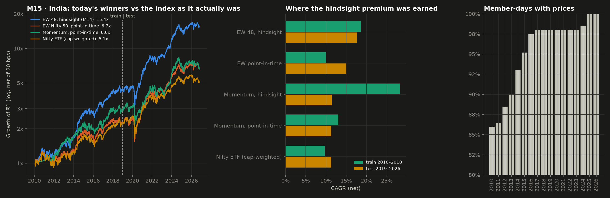

## Results

### M1 · Momentum (net of 10 bps, train 2010–2018, test 2019–2026)
| strategy | period | Sharpe (gross) | Sharpe (net) | CAGR (net) | vol | maxDD | turnover/yr |
|---|---|---|---|---|---|---|---|
| XS momentum 12-1 | train | 0.52 | 0.48 | 6.9% | 15.3% | -21.1% | 5.23 |
| XS momentum 12-1 | test | 0.77 | 0.74 | 18.1% | 22.1% | -30.3% | 5.40 |
| MA 50/200 on SPY | train | 0.68 | 0.68 | 7.9% | 11.7% | -19.4% | 0.89 |
| MA 50/200 on SPY | test | 0.59 | 0.59 | 11.6% | 16.1% | -33.7% | 0.90 |
| Equal-weight 48 | train | 0.88 | 0.88 | 12.4% | 14.0% | -16.1% | 0.11 |
| Equal-weight 48 | test | 0.80 | 0.80 | 16.8% | 18.1% | -36.2% | 0.00 |
| Buy & hold SPY | train | 0.77 | 0.77 | 11.4% | 14.9% | -19.3% | 0.11 |
| Buy & hold SPY | test | 0.80 | 0.80 | 17.6% | 19.2% | -33.7% | 0.00 |

Turnover is one-way, in multiples of capital per year. Momentum's 2010 is in T-bills while the 12-month lookback warms up, which lowers its train CAGR slightly.

### M2 · Pairs scan (train)
120 pairs tested; **6 cointegrated at 5%, which is exactly the number expected by chance alone** (120 × 0.05). Of the 40 pairs with return correlation above 0.7, **38 are not cointegrated**.

| sector | a | b | corr | p (train) | p (test) | β | half-life (days) |
|---|---|---|---|---|---|---|---|
| Financials | C | GS | 0.757 | 0.000 | 0.700 | 0.933 | 35.9 |
| Financials | C | MS | 0.805 | 0.001 | 0.848 | 0.681 | 48.3 |
| Staples | KO | COST | 0.412 | 0.025 | 0.273 | 0.479 | 54.3 |
| Tech | MSFT | INTC | 0.570 | 0.032 | 0.815 | 1.388 | 62.3 |
| Discretionary | LOW | NKE | 0.417 | 0.034 | 0.370 | 1.118 | 54.3 |

### M2 · Pairs backtest (net of 10 bps)
| strategy | period | Sharpe (gross) | Sharpe (net) | CAGR (net) | vol | maxDD | turnover/yr |
|---|---|---|---|---|---|---|---|
| Pairs portfolio (5) | train | 0.94 | 0.67 | 2.6% | 3.3% | -3.1% | 8.95 |
| Pairs portfolio (5) | test | 0.33 | 0.17 | 3.6% | 5.7% | -10.6% | 9.27 |
| C/GS | train | 0.51 | 0.36 | 2.4% | 5.9% | -15.5% | 8.90 |
| C/GS | test | 0.67 | 0.51 | 5.9% | 6.3% | -11.7% | 9.82 |
| C/MS | train | 0.45 | 0.31 | 2.2% | 6.5% | -12.1% | 9.46 |
| C/MS | test | 0.25 | 0.15 | 3.8% | 9.5% | -19.3% | 9.04 |
| KO/COST | train | 0.42 | 0.27 | 2.0% | 6.4% | -11.2% | 9.24 |
| KO/COST | test | 0.32 | 0.19 | 4.0% | 7.9% | -10.9% | 9.95 |
| MSFT/INTC | train | 0.46 | 0.34 | 2.9% | 8.0% | -13.1% | 9.35 |
| MSFT/INTC | test | -0.16 | -0.21 | -3.4% | 20.1% | -66.2% | 8.78 |
| LOW/NKE | train | 0.42 | 0.32 | 2.7% | 8.0% | -13.8% | 7.79 |
| LOW/NKE | test | 0.34 | 0.26 | 5.1% | 10.8% | -25.9% | 8.78 |

CAGR includes T-bill interest on idle capital; the strategy is flat much of the time, so most of its CAGR in the test period is that interest.

### M3 · Train correlations of the building blocks
| | Momentum | Pairs | SPY | BND |
|---|---|---|---|---|
| Momentum | 1.00 | 0.06 | 0.90 | -0.26 |
| Pairs | 0.06 | 1.00 | 0.06 | -0.00 |
| SPY | 0.90 | 0.06 | 1.00 | -0.30 |
| BND | -0.26 | -0.00 | -0.30 | 1.00 |

Train-fitted weights (max Sharpe and min variance came out **identical**): Momentum 0%, Pairs 40%, SPY 20%, BND 40%. In-sample Sharpe 1.31.

| building block | excess Sharpe, train | excess Sharpe, test |
|---|---|---|
| Momentum | 0.52 | 0.74 |
| Pairs | 0.77 | 0.17 |
| SPY | 0.76 | 0.80 |
| BND | 0.71 | **-0.18** |

### M3 · Allocation out of sample (net, from April 2014; test = 2019–2026)
| strategy | period | Sharpe (gross) | Sharpe (net) | CAGR (net) | vol | maxDD | turnover/yr |
|---|---|---|---|---|---|---|---|
| Max-Sharpe (train fit) | train | 0.94 | 0.94 | 3.5% | 3.0% | -3.6% | 0.00 |
| Max-Sharpe (train fit) | test | 0.52 | 0.52 | 5.7% | 5.7% | -11.3% | 0.00 |
| Walk-forward max-Sharpe | train | 0.61 | 0.59 | 2.8% | 3.6% | -7.8% | 0.38 |
| Walk-forward max-Sharpe | test | 0.66 | 0.65 | 8.6% | 9.1% | -12.1% | 0.88 |
| Equal-weight 4 | train | 0.66 | 0.66 | 5.1% | 7.0% | -9.9% | 0.00 |
| Equal-weight 4 | test | 0.76 | 0.76 | 10.6% | 10.4% | -17.9% | 0.00 |
| SPY | train | 0.64 | 0.64 | 8.6% | 13.3% | -19.3% | 0.00 |
| SPY | test | 0.80 | 0.80 | 17.6% | 19.2% | -33.7% | 0.00 |

### M4 · Simulated risk (models fit on train, 10,000 × 5-year paths)
| portfolio | model | 1d VaR99 | 1d CVaR99 | 1m CVaR95 | 5y p5 | 5y p50 | 5y p95 | P(5y loss) | maxDD median | maxDD worst 5% |
|---|---|---|---|---|---|---|---|---|---|---|
| Max-Sharpe (M3) | Normal | 0.4% | 0.5% | 1.5% | 12.0% | 25.4% | 40.4% | 0.0% | -3.6% | -6.0% |
| Max-Sharpe (M3) | Bootstrap | 0.5% | 0.7% | 1.4% | 13.5% | 25.7% | 38.6% | 0.0% | -3.6% | -5.7% |
| Max-Sharpe (M3) | **Realized (test)** | **0.8%** | **1.5%** | | | | | | | |
| Equal-weight 4 | Normal | 1.1% | 1.2% | 3.8% | 4.8% | 36.6% | 78.2% | 2.7% | -10.4% | -18.1% |
| Equal-weight 4 | Bootstrap | 1.3% | 1.8% | 3.7% | 9.8% | 37.3% | 68.9% | 1.2% | -9.2% | -15.6% |
| Equal-weight 4 | **Realized (test)** | **1.7%** | **2.8%** | | | | | | | |
| SPY | Normal | 2.1% | 2.4% | 7.5% | 0.4% | 68.8% | 184.2% | 4.9% | -20.3% | -34.3% |
| SPY | Bootstrap | 2.6% | 3.6% | 7.7% | 9.3% | 71.4% | 163.3% | 2.4% | -18.0% | -30.6% |
| SPY | **Realized (test)** | **3.4%** | **5.1%** | | | | | | | |

### M4 · VaR backtest: how often test-period losses broke the train-fit VaR
| portfolio | model | VaR95 | breached (target 5%) | VaR99 | breached (target 1%) |
|---|---|---|---|---|---|
| Max-Sharpe (M3) | Normal | 0.3% | 11.1% | 0.4% | 6.0% |
| Max-Sharpe (M3) | Bootstrap | 0.3% | 12.2% | 0.5% | 3.7% |
| Equal-weight 4 | Normal | 0.7% | 7.6% | 1.1% | 3.4% |
| Equal-weight 4 | Bootstrap | 0.8% | 7.4% | 1.3% | 1.8% |
| SPY | Normal | 1.5% | 6.9% | 2.1% | 3.3% |
| SPY | Bootstrap | 1.5% | 6.9% | 2.6% | 2.3% |

### M8 · Test-period Sharpe with 95% block-bootstrap intervals
| strategy | Sharpe | 95% CI low | 95% CI high | PSR (SR > 0) | DSR (N = 8) |
|---|---|---|---|---|---|
| Buy & hold SPY | 0.80 | 0.10 | 1.52 | 0.99 | 0.91 |
| Equal-weight 48 | 0.80 | 0.08 | 1.61 | 0.99 | 0.91 |
| XS momentum 12-1 | 0.74 | 0.17 | 1.38 | 0.98 | 0.89 |
| MA 50/200 on SPY | 0.59 | -0.05 | 1.36 | 0.95 | 0.78 |
| Pairs portfolio (5) | 0.17 | -0.51 | 0.83 | 0.68 | 0.35 |
| Max-Sharpe (train fit) | 0.52 | -0.17 | 1.30 | 0.92 | 0.72 |
| Walk-forward max-Sharpe | 0.65 | 0.02 | 1.30 | 0.96 | 0.83 |
| Equal-weight 4 | 0.76 | 0.11 | 1.49 | 0.98 | 0.89 |

The Sharpe that the best of these 8 would reach by luck alone if all were truly zero: **0.31**.

### M8 · The comparisons the project's conclusions rest on
| comparison | ΔSharpe | 95% CI low | 95% CI high | p-value |
|---|---|---|---|---|
| Equal-weight 4 − Max-Sharpe (train fit) | 0.23 | -0.11 | 0.63 | 0.17 |
| Walk-forward max-Sharpe − Max-Sharpe (train fit) | 0.12 | -0.41 | 0.58 | 0.64 |
| XS momentum 12-1 − Equal-weight 48 | -0.06 | -0.54 | 0.35 | 0.79 |
| Equal-weight 48 − Buy & hold SPY | 0.00 | -0.28 | 0.40 | 0.85 |
| Buy & hold SPY − Equal-weight 4 | 0.04 | -0.22 | 0.25 | 0.89 |

### M9 · Four VaR models backtested on 2019–2026 (Kupiec: breach rate; Christoffersen: clustering; p < 0.05 rejects)
| portfolio | model | breach95 | Kupiec p95 | Christoffersen p95 | breach99 | Kupiec p99 | Christoffersen p99 |
|---|---|---|---|---|---|---|---|
| Max-Sharpe (M3) | Static normal | 11.1% | 0.000 | 0.005 | 6.0% | 0.000 | 0.000 |
| Max-Sharpe (M3) | Static historical | 11.9% | 0.000 | 0.002 | 3.8% | 0.000 | 0.002 |
| Max-Sharpe (M3) | EWMA normal | 4.6% | 0.368 | 0.974 | 2.1% | 0.000 | 0.055 |
| Max-Sharpe (M3) | EWMA filtered historical | 5.3% | 0.507 | 0.803 | 1.1% | 0.738 | 0.019 |
| Equal-weight 4 | Static normal | 7.6% | 0.000 | 0.009 | 3.4% | 0.000 | 0.000 |
| Equal-weight 4 | Static historical | 7.3% | 0.000 | 0.021 | 1.8% | 0.002 | 0.000 |
| Equal-weight 4 | EWMA normal | 5.4% | 0.444 | 0.562 | 1.9% | 0.000 | 0.041 |
| Equal-weight 4 | EWMA filtered historical | 5.2% | 0.646 | 0.765 | 0.9% | 0.728 | 0.157 |
| SPY | Static normal | 6.9% | 0.000 | 0.031 | 3.3% | 0.000 | 0.021 |
| SPY | Static historical | 6.7% | 0.001 | 0.080 | 2.2% | 0.000 | 0.015 |
| SPY | EWMA normal | 5.7% | 0.142 | 0.526 | 2.3% | 0.000 | 0.361 |
| SPY | EWMA filtered historical | 5.6% | 0.243 | 0.432 | 1.0% | 0.907 | 0.178 |

### M11 · Six-factor regressions (net excess returns; Newey-West t-stats; test ends 2026-08-31)
| strategy | period | alpha/yr | t(alpha) | p(alpha) | β Mkt-RF | β SMB | β HML | β RMW | β CMA | β Mom | R² | days |
|---|---|---|---|---|---|---|---|---|---|---|---|---|
| Buy & hold SPY | train | -0.4% | -1.59 | 0.11 | 0.99 | -0.14 | 0.00 | 0.02 | 0.03 | -0.00 | 0.99 | 2264 |
| Buy & hold SPY | test | 0.0% | 0.04 | 0.97 | 0.98 | -0.10 | 0.02 | 0.04 | 0.04 | -0.01 | 0.99 | 1926 |
| Equal-weight 48 | train | 1.4% | 1.64 | 0.10 | 0.93 | -0.19 | 0.08 | 0.09 | 0.22 | -0.07 | 0.97 | 2264 |
| Equal-weight 48 | test | 1.8% | 0.92 | 0.36 | 0.87 | -0.09 | 0.28 | 0.05 | 0.27 | -0.08 | 0.91 | 1926 |
| XS momentum 12-1 | train | -4.1% | -1.48 | 0.14 | 0.86 | -0.22 | -0.14 | 0.04 | -0.02 | 0.17 | 0.71 | 2264 |
| XS momentum 12-1 | test | 0.7% | 0.19 | 0.85 | 0.97 | -0.17 | 0.38 | -0.24 | 0.27 | 0.34 | 0.78 | 1926 |
| MA 50/200 on SPY | train | -0.1% | -0.05 | 0.96 | 0.64 | -0.18 | -0.14 | 0.02 | 0.01 | 0.02 | 0.63 | 2264 |
| MA 50/200 on SPY | test | -2.1% | -0.69 | 0.49 | 0.72 | -0.07 | 0.06 | 0.02 | 0.10 | 0.13 | 0.73 | 1926 |
| Pairs portfolio (5) | train | 2.2% | 2.13 | 0.03 | 0.01 | 0.01 | -0.02 | 0.02 | -0.01 | -0.01 | 0.01 | 2264 |
| Pairs portfolio (5) | test | -0.0% | -0.02 | 0.98 | 0.05 | 0.02 | -0.02 | 0.05 | 0.04 | -0.02 | 0.04 | 1926 |
| Max-Sharpe (train fit) | train | 1.0% | 1.47 | 0.14 | 0.19 | -0.04 | -0.07 | 0.03 | 0.05 | -0.01 | 0.69 | 1198 |
| Max-Sharpe (train fit) | test | -0.5% | -0.42 | 0.67 | 0.23 | 0.01 | -0.03 | 0.03 | 0.04 | -0.02 | 0.66 | 1926 |
| Walk-forward max-Sharpe | train | -0.1% | -0.16 | 0.87 | 0.23 | -0.05 | -0.08 | 0.04 | 0.04 | -0.01 | 0.73 | 1198 |
| Walk-forward max-Sharpe | test | 0.0% | 0.01 | 0.99 | 0.38 | -0.03 | 0.02 | -0.04 | 0.04 | 0.05 | 0.66 | 1926 |
| Equal-weight 4 | train | -0.1% | -0.17 | 0.86 | 0.50 | -0.06 | -0.02 | 0.06 | 0.10 | 0.08 | 0.92 | 1198 |
| Equal-weight 4 | test | -0.2% | -0.15 | 0.88 | 0.51 | -0.05 | 0.08 | -0.03 | 0.09 | 0.07 | 0.90 | 1926 |

### M12 · Train-fitted weights and where each portfolio's risk comes from
| method | Momentum | Pairs | SPY | BND |
|---|---|---|---|---|
| Max-Sharpe (sample) | 0.0% | 40.0% | 20.0% | 40.0% |
| Max-Sharpe (Bayes-Stein μ, LW Σ) | 0.0% | 40.0% | 20.0% | 40.0% |
| Min-variance (LW Σ) | 0.0% | 40.0% | 20.0% | 40.0% |
| Risk parity | 6.1% | 37.0% | 7.2% | 49.7% |
| Equal-weight 4 | 25.0% | 25.0% | 25.0% | 25.0% |

Share of portfolio variance contributed by each stream (train covariance):

| method | Momentum | Pairs | SPY | BND |
|---|---|---|---|---|
| Max-Sharpe (sample) | 0.0% | 19.3% | 75.7% | 5.1% |
| Max-Sharpe (Bayes-Stein μ, LW Σ) | 0.0% | 19.3% | 75.7% | 5.1% |
| Min-variance (LW Σ) | 0.0% | 19.3% | 75.7% | 5.1% |
| Risk parity | 25.0% | 25.0% | 25.0% | 25.0% |
| Equal-weight 4 | 53.2% | 1.9% | 46.9% | -2.0% |

Ledoit-Wolf shrinkage intensity δ = 0.005; Bayes-Stein weight φ = 0.62.

### M12 · Robust allocations out of sample (net, from April 2014)
| strategy | period | Sharpe (gross) | Sharpe (net) | CAGR (net) | vol | maxDD | turnover/yr |
|---|---|---|---|---|---|---|---|
| Max-Sharpe (sample) | train | 0.94 | 0.94 | 3.5% | 3.0% | -3.6% | 0.00 |
| Max-Sharpe (sample) | test | 0.52 | 0.52 | 5.7% | 5.7% | -11.3% | 0.00 |
| Max-Sharpe (Bayes-Stein μ, LW Σ) | train | 0.94 | 0.94 | 3.5% | 3.0% | -3.6% | 0.00 |
| Max-Sharpe (Bayes-Stein μ, LW Σ) | test | 0.52 | 0.52 | 5.7% | 5.7% | -11.3% | 0.00 |
| Min-variance (LW Σ) | train | 0.94 | 0.94 | 3.5% | 3.0% | -3.6% | 0.00 |
| Min-variance (LW Σ) | test | 0.52 | 0.52 | 5.7% | 5.7% | -11.3% | 0.00 |
| Risk parity | train | 0.93 | 0.93 | 3.0% | 2.4% | -2.2% | 0.00 |
| Risk parity | test | 0.38 | 0.38 | 4.6% | 5.0% | -9.9% | 0.00 |
| Equal-weight 4 | train | 0.66 | 0.66 | 5.1% | 7.0% | -9.9% | 0.00 |
| Equal-weight 4 | test | 0.76 | 0.76 | 10.6% | 10.4% | -17.9% | 0.00 |
| Walk-forward risk parity | train | 0.87 | 0.86 | 2.9% | 2.6% | -2.5% | 0.29 |
| Walk-forward risk parity | test | 0.52 | 0.52 | 5.5% | 5.2% | -8.8% | 0.11 |

| comparison (test) | ΔSharpe | 95% CI low | 95% CI high | p-value |
|---|---|---|---|---|
| Max-Sharpe (sample) − Equal-weight 4 | -0.23 | -0.63 | 0.11 | 0.17 |
| Max-Sharpe (Bayes-Stein μ, LW Σ) − Equal-weight 4 | -0.23 | -0.63 | 0.11 | 0.17 |
| Min-variance (LW Σ) − Equal-weight 4 | -0.23 | -0.63 | 0.11 | 0.17 |
| Risk parity − Equal-weight 4 | -0.38 | -0.82 | 0.02 | 0.06 |
| Walk-forward risk parity − Equal-weight 4 | -0.24 | -0.60 | 0.09 | 0.16 |

### M13 · Pooled out-of-sample 2014–2026 (12.8 years) vs the single 2019 split
| strategy | Sharpe 2014–2026 | 95% CI low | 95% CI high | CI width | CI width 2019–2026 only | years beating SPY | worst year | best year |
|---|---|---|---|---|---|---|---|---|
| Buy & hold SPY | 0.73 | 0.23 | 1.32 | 1.08 | 1.43 | – | -18.2% | 31.2% |
| Equal-weight 48 | 0.77 | 0.26 | 1.37 | 1.11 | 1.53 | 6/13 | -3.1% | 32.4% |
| XS momentum 12-1 | 0.64 | 0.22 | 1.14 | 0.92 | 1.21 | 4/13 | -7.1% | 29.7% |
| MA 50/200 on SPY | 0.55 | 0.07 | 1.14 | 1.07 | 1.41 | 2/13 | -6.6% | 28.7% |
| Pairs portfolio (5) | 0.01 | -0.52 | 0.53 | 1.05 | 1.32 | 2/13 | -5.0% | 7.3% |
| Max-Sharpe (re-fit yearly) | 0.56 | 0.04 | 1.18 | 1.14 | 1.43 | 2/13 | -8.2% | 12.4% |
| Equal-weight 4 | 0.69 | 0.21 | 1.25 | 1.04 | 1.41 | 3/13 | -3.2% | 17.8% |

| comparison (2014–2026) | ΔSharpe | 95% CI low | 95% CI high | p-value |
|---|---|---|---|---|
| Equal-weight 4 − Max-Sharpe (re-fit yearly) | 0.13 | -0.11 | 0.39 | 0.27 |
| XS momentum 12-1 − Equal-weight 48 | -0.12 | -0.48 | 0.18 | 0.39 |
| Equal-weight 48 − Buy & hold SPY | 0.03 | -0.18 | 0.31 | 0.64 |
| Buy & hold SPY − Equal-weight 4 | 0.04 | -0.14 | 0.21 | 0.66 |

### M13 · Calendar-year net returns, each year out of sample
| year | Buy & hold SPY | Equal-weight 48 | XS momentum 12-1 | MA 50/200 on SPY | Pairs portfolio (5) | Max-Sharpe (re-fit yearly) | Equal-weight 4 | T-bills |
|---|---|---|---|---|---|---|---|---|
| 2014 | 13.5% | 16.5% | 13.2% | 13.5% | 4.4% | 6.9% | 9.4% | 0.0% |
| 2015 | 1.2% | -0.2% | 3.6% | -4.3% | 0.5% | 0.9% | 1.8% | 0.1% |
| 2016 | 12.0% | 14.7% | -1.7% | -0.5% | -0.1% | 3.4% | 3.3% | 0.3% |
| 2017 | 21.7% | 20.7% | 29.7% | 21.7% | -5.0% | 3.6% | 11.9% | 0.9% |
| 2018 | -4.6% | -3.1% | -7.1% | 0.8% | -1.1% | -1.1% | -2.7% | 1.9% |
| 2019 | 31.2% | 28.9% | 24.7% | 16.7% | 7.1% | 12.4% | 17.8% | 2.1% |
| 2020 | 18.3% | 9.4% | 16.8% | -4.4% | 2.4% | 8.6% | 12.7% | 0.4% |
| 2021 | 28.7% | 32.4% | 22.5% | 28.7% | -1.1% | 4.1% | 11.8% | 0.0% |
| 2022 | -18.2% | 3.0% | 17.2% | -6.6% | 1.4% | -8.2% | -3.2% | 2.0% |
| 2023 | 26.2% | 9.9% | 5.0% | 19.5% | 7.3% | 9.1% | 11.1% | 5.2% |
| 2024 | 24.9% | 15.5% | 19.8% | 24.9% | -1.9% | 5.3% | 10.8% | 5.1% |
| 2025 | 17.7% | 18.4% | 15.0% | 1.0% | 6.6% | 11.6% | 12.2% | 4.1% |
| 2026 | 15.4% | 15.4% | 20.2% | 15.4% | 4.4% | 7.1% | 9.4% | 2.8% |

2026 runs to Oct 6.

### M13 · What each cutoff fitted
| year | train days | pairs selected | w Momentum | w Pairs | w SPY | w BND |
|---|---|---|---|---|---|---|
| 2014 | 1006 | C/GS, SO/ED, PEP/PG, MRK/ABT, C/MS | 0.0% | 40.0% | 20.0% | 40.0% |
| 2015 | 1258 | C/GS, ABT/LLY, PEP/PG, C/MS, SO/ED | 0.0% | 40.0% | 20.0% | 40.0% |
| 2016 | 1510 | C/GS, C/MS, MRK/ABT, NEE/D, GS/MS | 0.0% | 40.0% | 20.0% | 40.0% |
| 2017 | 1762 | C/GS, C/MS, NEE/D, HON/GE, NEE/AEP | 0.0% | 40.0% | 20.0% | 40.0% |
| 2018 | 2013 | C/MS, C/GS, GS/MS, NEE/AEP, KO/COST | 0.0% | 40.0% | 20.0% | 40.0% |
| 2019 | 2264 | C/GS, C/MS, KO/COST, MSFT/INTC, LOW/NKE | 0.0% | 40.0% | 20.0% | 40.0% |
| 2020 | 2516 | C/MS, C/GS, KO/COST, GS/MS, BAC/C | 0.0% | 40.0% | 20.0% | 40.0% |
| 2021 | 2769 | KO/COST, C/GS, LOW/NKE, GS/MS, C/MS | 0.0% | 40.0% | 20.0% | 40.0% |
| 2022 | 3021 | LOW/NKE, KO/COST, GS/MS, AAPL/ORCL, AAPL/MSFT | 0.0% | 40.0% | 20.0% | 40.0% |
| 2023 | 3272 | GS/MS, KO/COST, AAPL/ORCL, CAT/DE, LOW/NKE | 7.1% | 40.0% | 13.5% | 39.4% |
| 2024 | 3522 | KO/COST, GS/MS, AAPL/MSFT, PEP/COST, CAT/DE | 1.0% | 40.0% | 22.8% | 36.1% |
| 2025 | 3774 | KO/COST, AAPL/MSFT, KO/PG, PG/COST | 0.0% | 31.8% | 40.0% | 28.2% |
| 2026 | 4024 | KO/COST, AAPL/MSFT, HON/UNP | 7.5% | 12.5% | 40.0% | 40.0% |

### M14 · India: the design on 48 NSE large caps (net of 20 bps, Sharpe over call money)
| strategy | period | Sharpe (gross) | Sharpe (net) | CAGR (net) | vol | maxDD | turnover/yr |
|---|---|---|---|---|---|---|---|
| Buy & hold Nifty | train | 0.19 | 0.19 | 9.7% | 17.6% | -27.3% | 0.11 |
| Buy & hold Nifty | test | 0.40 | 0.40 | 11.3% | 15.5% | -36.3% | 0.00 |
| Equal-weight 48 | train | 0.74 | 0.73 | 18.6% | 14.5% | -21.6% | 0.11 |
| Equal-weight 48 | test | 0.70 | 0.70 | 17.6% | 17.1% | -35.8% | 0.00 |
| XS momentum 12-1 | train | 1.24 | 1.18 | 28.3% | 15.9% | -19.4% | 4.69 |
| XS momentum 12-1 | test | 0.40 | 0.35 | 11.4% | 21.6% | -37.3% | 5.69 |
| MA 50/200 on Nifty | train | -0.04 | -0.07 | 6.4% | 10.4% | -15.2% | 1.37 |
| MA 50/200 on Nifty | test | 0.09 | 0.07 | 5.9% | 11.8% | -35.7% | 1.57 |
| Pairs portfolio (5) | train | 1.51 | 1.10 | 13.6% | 4.9% | -3.1% | 10.25 |
| Pairs portfolio (5) | test | 0.11 | -0.29 | 4.2% | 4.6% | -7.8% | 9.29 |
| Max-Sharpe (train fit) | train | 1.34 | 1.34 | 19.0% | 7.5% | -7.0% | 0.13 |
| Max-Sharpe (train fit) | test | 0.54 | 0.54 | 11.0% | 9.9% | -17.5% | 0.00 |
| Equal-weight 4 | train | 0.85 | 0.84 | 15.0% | 7.9% | -7.3% | 0.13 |
| Equal-weight 4 | test | 0.66 | 0.66 | 12.5% | 10.2% | -20.8% | 0.00 |

India's pairs scan: **18 of 120 cointegrated at 5%** (6 expected by chance); only 2 pairs have return correlation above 0.7.

| sector | a | b | corr | p (train) | p (test) | β | half-life (days) |
|---|---|---|---|---|---|---|---|
| Pharma | DRREDDY | LUPIN | 0.323 | 0.000 | 0.185 | 0.594 | 27.601 |
| Materials | TATASTEEL | HINDALCO | 0.644 | 0.001 | 0.067 | 0.862 | 40.579 |
| Financials | KOTAKBANK | BAJFINANCE | 0.303 | 0.001 | 0.000 | 0.450 | 34.952 |
| Auto | BAJAJ-AUTO | EICHERMOT | 0.236 | 0.002 | 0.164 | 0.268 | 47.440 |
| Financials | HDFCBANK | BAJFINANCE | 0.283 | 0.002 | 0.343 | 0.406 | 31.583 |

Train-fitted max-Sharpe weights: Momentum 40%, Pairs 40%, Nifty 0%, Gold 20%.

### M14 · US vs India, test period 2019–2026
| strategy | US Sharpe | India Sharpe | US CAGR | India CAGR | US maxDD | India maxDD |
|---|---|---|---|---|---|---|
| Buy & hold SPY / Nifty | 0.80 | 0.40 | 17.6% | 11.3% | -33.7% | -36.3% |
| Equal-weight 48 | 0.80 | 0.70 | 16.8% | 17.6% | -36.2% | -35.8% |
| XS momentum 12-1 | 0.74 | 0.35 | 18.1% | 11.4% | -30.3% | -37.3% |
| MA 50/200 on SPY / Nifty | 0.59 | 0.07 | 11.6% | 5.9% | -33.7% | -35.7% |
| Pairs portfolio (5) | 0.17 | -0.29 | 3.6% | 4.2% | -10.6% | -7.8% |
| Max-Sharpe (train fit) | 0.52 | 0.54 | 5.7% | 11.0% | -11.3% | -17.5% |
| Equal-weight 4 | 0.76 | 0.66 | 10.6% | 12.5% | -17.9% | -20.8% |

### M14 · Cost sensitivity (test Sharpe over the local short rate)
| cost (bps) | US · XS momentum 12-1 | US · Pairs portfolio (5) | India · XS momentum 12-1 | India · Pairs portfolio (5) |
|---|---|---|---|---|
| 0 | 0.77 | 0.33 | 0.40 | 0.11 |
| 10 | 0.74 | 0.17 | 0.37 | -0.09 |
| 20 | 0.72 | 0.01 | 0.35 | -0.29 |
| 30 | 0.69 | -0.16 | 0.32 | -0.49 |
| 40 | 0.67 | -0.32 | 0.29 | -0.69 |
| 60 | 0.62 | -0.64 | 0.24 | -1.09 |

### M14 · India test-period uncertainty
| strategy / comparison | Sharpe or ΔSharpe | 95% CI low | 95% CI high | p-value |
|---|---|---|---|---|
| Buy & hold Nifty | 0.40 | -0.39 | 1.27 | – |
| Equal-weight 48 | 0.70 | -0.04 | 1.54 | – |
| XS momentum 12-1 | 0.35 | -0.34 | 1.12 | – |
| MA 50/200 on Nifty | 0.07 | -0.77 | 0.97 | – |
| Pairs portfolio (5) | -0.29 | -0.91 | 0.35 | – |
| Max-Sharpe (train fit) | 0.54 | -0.13 | 1.33 | – |
| Equal-weight 4 | 0.66 | -0.04 | 1.48 | – |
| XS momentum 12-1 − Equal-weight 48 | -0.36 | -0.81 | 0.07 | 0.10 |
| Equal-weight 4 − Max-Sharpe (train fit) | 0.12 | -0.09 | 0.33 | 0.27 |
| Equal-weight 48 − Buy & hold Nifty | 0.30 | 0.05 | 0.56 | 0.02 |

### M15 · Hindsight vs point-in-time (India, net of 20 bps, Sharpe over call money)
| strategy | period | Sharpe (gross) | Sharpe (net) | CAGR (net) | vol | maxDD | turnover/yr |
|---|---|---|---|---|---|---|---|
| Nifty ETF (cap-weighted) | train | 0.19 | 0.19 | 9.7% | 17.6% | -27.3% | 0.11 |
| Nifty ETF (cap-weighted) | test | 0.40 | 0.40 | 11.3% | 15.5% | -36.3% | 0.00 |
| EW Nifty 50, point-in-time | train | 0.21 | 0.21 | 10.0% | 15.9% | -26.8% | 0.27 |
| EW Nifty 50, point-in-time | test | 0.57 | 0.57 | 15.0% | 17.3% | -38.8% | 0.09 |
| EW Nifty 50, point-in-time (gaps in cash) | train | 0.22 | 0.22 | 10.0% | 14.7% | -23.2% | 0.24 |
| EW Nifty 50, point-in-time (gaps in cash) | test | 0.57 | 0.57 | 14.9% | 17.1% | -38.2% | 0.09 |
| EW 48, hindsight (M14) | train | 0.74 | 0.73 | 18.6% | 14.5% | -21.6% | 0.11 |
| EW 48, hindsight (M14) | test | 0.70 | 0.70 | 17.6% | 17.1% | -35.8% | 0.00 |
| Momentum, point-in-time | train | 0.45 | 0.38 | 13.0% | 16.0% | -21.6% | 5.52 |
| Momentum, point-in-time | test | 0.41 | 0.35 | 11.3% | 20.5% | -36.3% | 5.80 |
| Momentum, hindsight (M14) | train | 1.24 | 1.18 | 28.3% | 15.9% | -19.4% | 4.69 |
| Momentum, hindsight (M14) | test | 0.40 | 0.35 | 11.4% | 21.6% | -37.3% | 5.69 |

| comparison | period | ΔCAGR | ΔSharpe | 95% CI low | 95% CI high | p-value |
|---|---|---|---|---|---|---|
| EW Nifty 50, point-in-time − Nifty ETF (cap-weighted) | train | 0.3% | 0.02 | -0.19 | 0.24 | 0.91 |
| EW Nifty 50, point-in-time − Nifty ETF (cap-weighted) | test | 3.8% | 0.17 | -0.03 | 0.39 | 0.09 |
| EW 48, hindsight (M14) − EW Nifty 50, point-in-time | train | 8.6% | 0.52 | 0.36 | 0.69 | 0.00 |
| EW 48, hindsight (M14) − EW Nifty 50, point-in-time | test | 2.6% | 0.13 | -0.02 | 0.29 | 0.09 |
| Momentum, hindsight (M14) − Momentum, point-in-time | train | 15.3% | 0.80 | 0.49 | 1.12 | 0.00 |
| Momentum, hindsight (M14) − Momentum, point-in-time | test | 0.1% | -0.00 | -0.27 | 0.27 | 0.99 |
| Momentum, point-in-time − EW Nifty 50, point-in-time | train | 3.0% | 0.17 | -0.36 | 0.66 | 0.50 |
| Momentum, point-in-time − EW Nifty 50, point-in-time | test | -3.8% | -0.22 | -0.66 | 0.19 | 0.29 |

### M15 · Price coverage of Nifty 50 member-days
| year | member-days | with prices | coverage | missing names |
|---|---|---|---|---|
| 2010 | 11600 | 9976 | 86.0% | CAIRN, HDFC, IDFC, JPASSOCIAT, RANBAXY, RELCAPITAL, STER |
| 2011 | 12300 | 10633 | 86.4% | CAIRN, HDFC, IDFC, JPASSOCIAT, RANBAXY, RELCAPITAL, STER |
| 2012 | 12250 | 10840 | 88.5% | CAIRN, HDFC, IDFC, JPASSOCIAT, RANBAXY, STER |
| 2013 | 12400 | 11160 | 90.0% | CAIRN, HDFC, IDFC, JPASSOCIAT, RANBAXY |
| 2014 | 12200 | 11348 | 93.0% | CAIRN, HDFC, IDFC, JPASSOCIAT, RANBAXY |
| 2015 | 12350 | 11756 | 95.2% | CAIRN, HDFC, IDFC |
| 2016 | 12300 | 11993 | 97.5% | CAIRN, HDFC |
| 2017 | 12400 | 12152 | 98.0% | HDFC |
| 2018 | 12300 | 12054 | 98.0% | HDFC |
| 2019 | 12150 | 11907 | 98.0% | HDFC |
| 2020 | 12550 | 12299 | 98.0% | HDFC |
| 2021 | 12400 | 12152 | 98.0% | HDFC |
| 2022 | 12400 | 12152 | 98.0% | HDFC |
| 2023 | 12250 | 12005 | 98.0% | HDFC, LTIM |
| 2024 | 12300 | 12117 | 98.5% | LTIM |
| 2025 | 12450 | 12450 | 100.0% | – |
| 2026 | 10000 | 10000 | 100.0% | – |

## What failed

**M1: momentum did not beat its own universe.** Cross-sectional momentum had a lower Sharpe than simply holding all 48 stocks equally, in both train (0.48 vs 0.88) and test (0.74 vs 0.80). It took on more volatility (22% vs 18% in test) without enough extra return to pay for it. Costs were *not* the reason: at about 5x annual turnover, 10 bps costs only about 0.03 Sharpe. The signal itself added little, which is consistent with momentum being a crowded, well-known anomaly, and with 48 mega-caps being too narrow a cross-section for ranking to matter much. (M8: the test-period gap of −0.06 is far from significant, p = 0.79.)

**M1: trend-following cut returns more than risk.** The 50/200 MA rule had the lowest test CAGR (11.6%) and Sharpe (0.59) of M1's strategies. It still suffered SPY's full −33.7% drawdown, because the 2020 crash was faster than a 200-day average can react, and then it sat in T-bills during the rebound. Its only benefit was lower volatility, from time spent out of the market.

**M2: the cointegration screen found nothing beyond chance.** 6 of 120 pairs passed at 5%, the same number a screen of pure noise would produce. Out of sample, **none of the 5 selected pairs was still cointegrated** (test p-values 0.27–0.85). The "statistical relationship" the strategy was built on did not exist in a form that persists.

**M2: it still made a little money, for a different reason than intended.** The C/GS spread broke structurally after 2020 (it drifted from about −1.0 to −1.7; see the walkthrough figure), yet C/GS had the *best* test Sharpe (0.51). The 60-day rolling mean follows the drift, so the strategy is really trading short-term reversion around a moving average, not the long-run equilibrium it was selected for. Cointegration was the reason for picking these pairs, but it wasn't where the profit came from.

**M2: one broken pair dominates the risk.** MSFT/INTC lost 66% peak-to-trough in test, as Microsoft and Intel's fortunes split permanently. The ±4 stop exits a position, but the rule re-enters once the rolling z-score resets, so a trending spread is traded again and again. A rule that drops a pair whose rolling cointegration p-value fails would have helped. That rule wasn't added, because it would be designed after seeing the test result.

**M2: costs matter at this turnover.** About 9x annual turnover cut the portfolio's Sharpe by 29–48% (0.94 → 0.67 train, 0.33 → 0.17 test). Pairs are far more cost-sensitive than M1's momentum. Over T-bills, the test-period portfolio earned about 1% a year, and its Sharpe interval comfortably includes zero (PSR 0.68, M8).

**M3: the optimizer discarded momentum entirely.** With 0.90 correlation to SPY and a lower Sharpe in train, momentum added only risk, so the optimizer gave it 0%. This confirms M1: in this universe, momentum is mostly a noisier version of the market.

**M3: the optimizer was driven by the constraints, not the estimates.** Max Sharpe and min variance landed on the *same* corner: 40% pairs, 40% BND, 20% SPY. Pairs and BND are the two lowest-volatility streams and are nearly uncorrelated with everything, so the optimizer pushed both to the 40% cap and gave the leftover 20% to SPY. The 40% cap, a number chosen by hand, determined the answer more than $\mu$ or $\Sigma$ did.

**M3: optimization lost to 1/N out of sample, because what looked safest broke.** The train-fit portfolio's in-sample Sharpe of 1.31 fell to 0.52 in test, against **0.76** for the naive 25%-each mix and 0.80 for SPY. The cause is visible in the building blocks: the two streams loaded to the cap collapsed, **BND from 0.71 to −0.18** (the 2022 rate shock, as T-bills rose to 5%) and pairs from 0.77 to 0.17. This is the estimation-error problem of DeMiguel, Garlappi & Uppal (2009): $\mu$ estimated from one regime is a poor guide to the next. The optimizer did deliver low risk (max drawdown −11.3% vs −33.7% for SPY), but gave up about 12 points of annual return to get it. (M8: the 0.23 Sharpe gap to 1/N is not significant, p = 0.17. The ranking matches the literature, but this sample alone can't prove it.)

**M3: the "optimal" weights are unstable.** Re-fit quarterly on the trailing 3 years, every weight swings across its whole 0–40% range (see the walk-forward panel). Momentum sat at the cap through most of 2022–2025, right after its strong 2020–2021 run, which is chasing past performance. Walk-forward beat the frozen fit (Sharpe 0.65 vs 0.52, CAGR 8.6% vs 5.7%), but that gap is noise too (p = 0.64).

**M4: the normal model understates daily tail risk, as expected.** Train daily returns have excess kurtosis of 4.8–6.4 (a normal distribution has 0). The bootstrap's 1-day CVaR99 is **about 50% larger** than the normal model's for SPY (3.6% vs 2.4%) and for equal-weight (1.8% vs 1.2%). Its 99% VaR is breached less often in test (1.8–3.7% of days vs 3.3–6.0%).

**M4: but both models failed the VaR backtest.** Every model breached its 99% VaR 2–6x more often than the 1% target, and its 95% VaR on 7–12% of days instead of 5%. Realized test CVaR99 was 1.4–3x what either model predicted. The cause is not the distribution's shape but **a regime change**: every building block was 30–90% more volatile in 2019–2026 (COVID, the 2022 rate shock) than in the calm 2011–2018 train period. A model with fixed volatility can't predict volatility it has never seen (M9 fixes this). The max-Sharpe portfolio fared worst (12.2% breaches at 95%), because the optimizer chose the streams that *looked* safest in train, pairs and BND, and their volatility nearly doubled.

**M4: fat tails are a short-horizon effect here.** At 5 years the ranking flips. The normal model is *more* pessimistic (SPY: 4.9% chance of a 5-year loss vs 2.4% bootstrap; 5th-percentile return 0.4% vs 9.3%). Train returns partly reverse over weeks (the variance of 21-day returns is only 0.56–0.68x what i.i.d. scaling implies), so the bootstrap's chained blocks wander less than a random walk with the same daily volatility. "Bootstrap = more conservative" is true for days, not years.

**M4: the bootstrap cannot imagine anything worse than history.** Its max-drawdown histogram spikes near −3.6% because most 5-year paths (60 blocks each) redraw the window around the worst train episode at least once. Resampling can rearrange the past but never exceed it, and the test period was worse than anything in the past.

**M8: the evidence is far weaker than the point estimates suggest.** Every 95% Sharpe interval is about 1.4 wide and they all overlap; three of eight (MA 50/200, pairs, max-Sharpe) include zero. None of the five comparisons the conclusions above rest on is significant (p = 0.17–0.89). With N = 8 strategies, the best one would reach a Sharpe of 0.31 by luck alone. No strategy clears a Deflated Sharpe Ratio of 0.95, and the two highest (0.91) are the passive benchmarks, SPY and equal-weight 48. The directional findings (momentum ≈ market, optimizer ≤ 1/N, pairs ≈ 0) agree with the published literature, but 7.8 years of test data are not enough to establish any of them independently.

**M9: a volatility-aware VaR fixes coverage; the tail shape still matters.** Both static models fail Kupiec for every portfolio at both levels (p ≤ 0.002 at 99%). Letting the volatility move (EWMA normal) fixes the 95% level (breaches 4.6–5.7%, Kupiec p ≥ 0.14) but still fails at 99% (1.9–2.3%, p = 0.000), because a normal tail is too thin. Combining today's volatility with the train period's standardized fat tail (**filtered historical simulation**) passes Kupiec at **both** levels for **all three** portfolios: 95% breaches 5.2–5.6% (p ≥ 0.24), 99% breaches 0.9–1.1% (p ≥ 0.73). It isn't perfect. For the max-Sharpe portfolio, its 99% breaches still cluster (Christoffersen p = 0.019), because an EWMA with λ = 0.94 takes a few days to catch up with a sudden shock like March 2020. That lag is visible in the figure.

**M11: no strategy has alpha once known factors are accounted for.** The method passes its sanity check (SPY: $\beta_{mkt}$ = 0.98, $R^2$ = 0.99, alpha 0.0%). Out of sample, every strategy's alpha is within noise of zero; the largest |t| is 0.92 (equal-weight 48, +1.8%/yr). Cross-sectional momentum is, as M1 suspected, mostly the market: $\beta_{mkt}$ = 0.97 with $R^2$ = 0.78. It *is* a genuine momentum strategy (MOM loading 0.34, t = 16.3), but the momentum factor itself earned only about 3% a year in 2019–2026, and after paying for it the strategy's alpha is +0.7%/yr (t = 0.19). Equal-weighting the 48 mega-caps is a value and conservative-investment tilt (HML 0.28, CMA 0.27) with a *negative* momentum loading (−0.08, t = −8.9): rebalancing back to equal weights sells winners.

**M11: the only significant alpha in the project is in-sample.** The pairs portfolio shows +2.2%/yr alpha in train with t = 2.13 (p = 0.03) and near-zero factor exposure ($R^2$ = 0.01), the profile of genuine market-neutral alpha. But those five pairs and their hedge ratios were selected *on that same data*. Out of sample its alpha is −0.0%/yr (t = −0.02). A t-stat of 2 on the data a strategy was chosen from is exactly what selection produces.

**M12: shrinkage changed the estimates but not the portfolio.** Ledoit-Wolf barely moved the covariance (δ = 0.005): with about 500 daily observations per asset, the sample covariance of four streams is already precise. Bayes-Stein moved the means a lot (φ = 0.62, i.e. 62% of the way to a common value), yet max Sharpe with shrunk means and Ledoit-Wolf covariance, and min-variance with no means at all, all land on the **identical** 40/20/40 corner. The allocation was never driven by noisy return estimates; it was driven by the low volatility of pairs and bonds plus the 40% cap. Shrinkage fixes estimation noise *within* a regime, and the failure here was a change *of* regime.

**M12: risk parity made it worse, for the same reason.** Equalizing risk contributions means owning the most of whatever was least volatile: 50% bonds and 37% pairs. Those were exactly the two streams that broke after 2018 (BND's excess Sharpe went from 0.71 to −0.18, pairs from 0.77 to 0.17). Risk parity had the lowest test Sharpe of any allocation (0.38) and the gap to 1/N (−0.38, p = 0.06) is the closest thing to a significant result in the project. It did deliver the smallest drawdowns (−9.9%; −8.8% walk-forward). Re-fitting it quarterly helped (0.52), but not enough to catch 1/N.

**M12: "1/N" won partly by being almost all equity risk.** Equal capital is not equal risk: 53% of equal-weight 4's variance came from momentum and 47% from SPY, so it was in effect a 100%-equity-risk portfolio, held through one of the strongest US equity decades on record. The 40/20/40 corner, by contrast, took 76% of its risk from a 20% SPY position. Which allocation "wins" depended mostly on which asset class the next regime rewarded, which is why none of these differences is significant (M8).

**M13: more data narrows the intervals, but not enough.** Pooling 12.8 out-of-sample years shrinks every Sharpe interval by 20–28% (SPY: 1.43 → 1.08 wide), close to the $\sqrt{7.8/12.8} \approx 0.78$ that theory predicts. The rankings hold: passive SPY and equal-weight 48 (0.73, 0.77) still lead, 1/N (0.69) still beats the optimizer (0.56). But every gap got *smaller* with more data (1/N − max-Sharpe: 0.23 → 0.13), and none of the four comparisons is significant (p = 0.27–0.66). Distinguishing Sharpe ratios this close would need decades, not years. That is a property of the problem, not of this project.

**M13: the pairs book is zero, and its pairs aren't stable.** Over 12.8 years of genuinely out-of-sample trading, the pairs portfolio's Sharpe over T-bills is **0.01** (95% CI −0.52 to 0.53). Its yearly returns track the T-bill rate it earns on idle capital (7.3% in 2023, when T-bills paid 5.2%). The "cointegrated" pairs themselves churn: 21 different pairs fill the 62 selection slots across 13 cutoffs, and only KO/COST, C/GS, C/MS and GS/MS recur often. C/GS was chosen every year from 2014 to 2021, then dropped as the relationship broke (M2). By 2025 and 2026 the screen finds only 4 and 3 pairs that pass at all. A relationship that has to be re-discovered every year with different members isn't a relationship.

**M13: the optimizer's corner is stable, and that's the problem.** Re-fit on nine different training windows (2014–2022), max Sharpe chose the *identical* 40% pairs / 20% SPY / 40% BND every time, so it held that allocation straight into 2022, when bonds and stocks fell together (−8.2%, its worst year). Only after 2022's data entered the training window did it move, and then toward 40% SPY by 2025–26, after equities' strong run. Stable weights aren't the same as robust ones, and re-fitting on the past reacts to regime changes only after they've happened.

**M13: momentum's value is concentrated in one year.** Cross-sectional momentum beat SPY in only 4 of 13 years. Its standout year was 2022 (+17.2% vs −18.2%), when the winners it held were energy stocks during the rate shock. That one year is most of the case for momentum as a diversifier, and one year is an anecdote. The 50/200 MA rule beat SPY in 2 of 13 years.

**M14: Indian momentum looked like the best strategy in the project, in sample.** Over 2010–2018, cross-sectional momentum on the 48 NSE names earned 28.3% a year with a Sharpe of 1.18, far above equal-weight (0.73) and the Nifty ETF (0.19). Out of sample it fell to 0.35, half of equal-weight's 0.70 (difference −0.36, p = 0.10). Part of the in-sample number is the momentum premium that is well documented in India. Part is the universe: a list of *today's* large caps is a list of stocks that went up, and momentum, which buys whatever has gone up most, gets the most out of that hindsight. Bajaj Finance, Eicher Motors and Divi's Labs are in the universe because they became large caps after rising many-fold, exactly the stocks a 2010–2018 momentum strategy would have held.

**M14: the one significant result is the one most likely to be an artifact (confirmed in M15).** Equal-weight 48 beat the Nifty ETF by 0.30 Sharpe out of sample (95% CI 0.05 to 0.56, p = 0.02). That's the first difference in the project that clears 5%. But the hindsight universe beat its own index by **8.9 points a year in train** (18.6% vs 9.7% CAGR) against about 1 point in the US (12.4% vs 11.4%). A portfolio of the companies that turned out to be India's winners beating the index that also held the losers is survivorship bias, not a strategy. In a market where the large-cap list turned over much faster than the US's, this bias is larger, and it shows. M15 runs the obvious next test, a point-in-time Nifty 50 universe, and confirms it.

**M14: Indian pairs are more cointegrated and still lose money.** India's screen found 18 pairs cointegrated at 5%, three times what chance predicts (US: exactly chance). One selected pair, Kotak Bank / Bajaj Finance, was still strongly cointegrated out of sample (p = 0.000), and Tata Steel / Hindalco nearly so (p = 0.07). The statistical relationship was more real than in the US. It didn't matter. The pairs book traded about 9x its capital a year, and at 20 bps that costs ~1.9% a year. Gross test Sharpe 0.11 became **−0.29** net. Pairs break even at about 5 bps in India and about 20 bps in the US. With 0.1% STT on every delivery sell, this strategy has no room to exist for an Indian retail trader.

**M14: the hurdle rate matters as much as the strategy.** Measured over India's 5.6% call-money rate, the Nifty ETF's 11.3% a year is a Sharpe of only 0.40, half of SPY's 0.80 over 2.75% T-bills. The 50/200 MA rule, which sits in cash much of the time, earns almost exactly the call-money rate (Sharpe 0.07 test, −0.07 train). The optimizer put 40% in momentum and 40% in pairs, the two best in-sample performers (train Sharpe 1.18 and 1.10), 20% in gold and 0% in the market. Both favourites collapsed out of sample (0.35 and −0.29). The portfolio still edged its US counterpart (0.54 vs 0.52), but only thanks to the asset it held purely as a diversifier: gold had a train Sharpe of −0.01 and then returned 20.4% a year in 2019–2026 (Sharpe 0.83). That's luck, not skill, and 1/N still beat it (p = 0.27).

**M15: the project's one significant result was survivorship bias.** M14 found equal-weight beating the Nifty ETF by 0.30 Sharpe out of sample (p = 0.02). Equal-weighting the companies that were *actually* in the Nifty 50 on each date gives a much smaller edge: +0.17 Sharpe out of sample (p = 0.09, not significant) and only +0.3% a year in train (p = 0.91). The rest of M14's gap came from knowing, in 2026, which companies would be India's large caps.

**M15: hindsight in the universe is worth 8.6% a year, and that one is significant.** Over 2010–2018, an equal-weight portfolio of today's 48 large caps beat an equal-weight portfolio of the actual Nifty 50 by **8.6% a year** (Sharpe +0.52, 95% CI 0.36 to 0.69, p < 0.001). It is the largest and most statistically solid effect anywhere in this project, and it is a pure artefact of how the universe was chosen. Out of sample the premium shrinks to 2.6% a year (p = 0.09), because the 2019–2026 hindsight list still benefits from knowing who would grow by 2026.

**M15: Indian momentum's in-sample record was half hindsight.** M14's momentum earned 28.3% a year in train, with a Sharpe of 1.18. Ranking only stocks that were actually in the index, the same rule earned **13.0%** (Sharpe 0.38). The 15.3-point gap is significant (p < 0.001). Momentum is where hindsight bias hurts most: it buys whatever has risen most, and a list of today's large caps is, by construction, a list of the stocks that rose most. Out of sample the two versions are identical (Sharpe 0.35 vs 0.35), and point-in-time momentum does not beat point-in-time equal-weight in either period (p = 0.50 train, 0.29 test).

**M15: the missing 4.6% doesn't drive the answer.** Filling the member-days without prices with the index return or with cash gives the same Sharpe to two decimals (0.21 vs 0.22 train, 0.57 vs 0.57 test). The bias that remains, the 8 deleted companies' own returns, is small next to the effects measured here, and its direction is unclear: HDFC Ltd's 2023 exit was a share-swap merger into HDFC Bank, while JP Associates and Reliance Capital collapsed.

## Limitations
- **Survivorship bias.** The US universe (and M14's Indian one) is today's large caps, chosen with hindsight. M15 measures what that is worth in India: 8.6% a year in train for equal-weight, 15.3% for momentum. The US equivalent is likely smaller (the US hindsight list beat SPY by only ~1 pt/yr in train, vs ~9 for India) but is not measured: a point-in-time US universe needs delisted-stock prices that free data doesn't have (CRSP or Norgate would).
- **Multiple testing.** The pair screen runs 120 hypothesis tests at 5% without a Bonferroni/BH correction; the M2 results show why this matters. M8's Deflated Sharpe uses N = 8, the strategies in the verdict table, which understates the true number of choices made (120 pairs scanned, two momentum variants, several allocations), so the DSRs reported are, if anything, optimistic.
- **Shorting costs.** Pairs' short legs pay no borrow fee, and short-sale proceeds earn no rebate. For these mega-caps borrow is cheap, but not free.
- **Risk-free rate.** The 3-month T-bill yield (discount basis) is used as a daily rate ÷ 252; the gap to an investment-yield convention is a few basis points.
- **Estimation error in M3.** $\mu$ is estimated from ~8 years of daily data; its standard error is of the same order as the differences between assets. The 40% cap is an arbitrary guard against that, and the results depend on it.
- **Stationarity.** M4's models assume the train distribution persists. M9 relaxes this for volatility but still assumes the train period's *standardized* tail shape persists, with a fixed λ = 0.94.
- **Engine simplification.** Target weights are held constant between signal changes (an implicit daily rebalance); turnover caused by price drift is not charged, so costs are slightly understated.
- **India data (M14).** Yahoo's NSE prices needed a spike filter and two replacements; corporate actions (demergers) are not adjusted by Yahoo and were screened by eye above a 12% threshold, so smaller distortions may remain. The call-money rate is monthly and overnight, not a 91-day bill. Stock-futures margin and roll costs for the pairs' short legs are approximated by the same cost rate.
- **One history.** M13 replaces the single 2019 cutoff with 13 yearly cutoffs, but all of them share one historical path and overlapping (anchored) training data, so the yearly results are not independent experiments. Design choices that weren't fitted (the universe, textbook rule parameters, the 40% cap, 10 bps costs) were fixed before any test data was seen, but they are the same at every cutoff.

## Further work
Each item comes from a specific failure above. All of them would need to be fit on train data only, and none was added after seeing test results:
- **Pair monitoring (M2).** Drop a pair when its rolling cointegration p-value fails, rather than relying on z-score stops; correct the screen for multiple testing (Benjamini–Hochberg).
- **Regime-aware allocation (M12).** Shrinkage and risk parity both assume the train regime persists. Volatility targeting, or covariances estimated from the M9 EWMA model, would let the allocation react when bond-equity correlations flip, as they did in 2022.
- **Better volatility models (M9).** GARCH(1,1) or a faster-reacting EWMA to reduce the clustering left in the max-Sharpe portfolio's 99% breaches.
- **Broader momentum (M1).** A larger universe and a long-short version to separate the momentum premium from market beta.
- **Survivorship-free US (M15).** Repeat M15 for the US with point-in-time S&P 500 or Dow membership; it needs a source for delisted prices (CRSP, Norgate). For India, NSE's daily bhavcopy archives include delisted stocks and would close M15's remaining 4.6% gap.

## References
- Jegadeesh, N. & Titman, S. (1993). Returns to buying winners and selling losers. *Journal of Finance*, 48(1).
- Engle, R. & Granger, C. (1987). Co-integration and error correction. *Econometrica*, 55(2).
- Gatev, E., Goetzmann, W. & Rouwenhorst, K. G. (2006). Pairs trading: performance of a relative-value arbitrage rule. *Review of Financial Studies*, 19(3).
- Markowitz, H. (1952). Portfolio selection. *Journal of Finance*, 7(1).
- DeMiguel, V., Garlappi, L. & Uppal, R. (2009). Optimal versus naive diversification: how inefficient is the 1/N portfolio strategy? *Review of Financial Studies*, 22(5).
- Künsch, H. (1989). The jackknife and the bootstrap for general stationary observations. *Annals of Statistics*, 17(3).
- Ledoit, O. & Wolf, M. (2008). Robust performance hypothesis testing with the Sharpe ratio. *Journal of Empirical Finance*, 15(5).
- Bailey, D. & López de Prado, M. (2012). The Sharpe ratio efficient frontier. *Journal of Risk*, 15(2).
- Bailey, D. & López de Prado, M. (2014). The deflated Sharpe ratio: correcting for selection bias, backtest overfitting and non-normality. *Journal of Portfolio Management*, 40(5).
- J.P. Morgan/Reuters (1996). *RiskMetrics — Technical Document*, 4th ed.
- Hull, J. & White, A. (1998). Incorporating volatility updating into the historical simulation method for value-at-risk. *Journal of Risk*, 1(1).
- Kupiec, P. (1995). Techniques for verifying the accuracy of risk measurement models. *Journal of Derivatives*, 3(2).
- Christoffersen, P. (1998). Evaluating interval forecasts. *International Economic Review*, 39(4).
- Fama, E. & French, K. (2015). A five-factor asset pricing model. *Journal of Financial Economics*, 116(1).
- Carhart, M. (1997). On persistence in mutual fund performance. *Journal of Finance*, 52(1).
- Newey, W. & West, K. (1994). Automatic lag selection in covariance matrix estimation. *Review of Economic Studies*, 61(4).
- Ledoit, O. & Wolf, M. (2004). A well-conditioned estimator for large-dimensional covariance matrices. *Journal of Multivariate Analysis*, 88(2).
- Jorion, P. (1986). Bayes-Stein estimation for portfolio analysis. *Journal of Financial and Quantitative Analysis*, 21(3).
- Maillard, S., Roncalli, T. & Teïletche, J. (2010). The properties of equally weighted risk contribution portfolios. *Journal of Portfolio Management*, 36(4).
- Griveau-Billion, T., Richard, J.-C. & Roncalli, T. (2013). A fast algorithm for computing high-dimensional risk parity portfolios. SSRN 2325255.

## Repository
| file | role |
|---|---|
| `data.py` | US and Indian universes, price and short-rate download + cache, cleaning (incl. the spike filter), the fixed train/test split |
| `backtest.py` | the only place P&L is computed: weights → lagged returns + interest on cash − costs; metrics |
| `momentum.py` · `pairs.py` | strategies; each returns target weights only |
| `frontier.py` | mean-variance optimizer, frontier, walk-forward re-fitting; Ledoit-Wolf, Bayes-Stein, risk parity (M12) |
| `factors.py` | Fama-French 5 + momentum download/cache and Newey-West factor regressions (M11) |
| `montecarlo.py` | normal and block-bootstrap simulation, VaR/CVaR, drawdowns; EWMA/FHS VaR and Kupiec/Christoffersen tests |
| `significance.py` | Sharpe confidence intervals, paired difference tests, PSR, Deflated Sharpe (M8) |
| `walkforward.py` | re-runs the full design at every yearly cutoff and stitches the out-of-sample years (M13) |
| `survivorship.py` | point-in-time Nifty 50 membership (rebuilt and self-checked from the index change log), prices for every past member, EW and momentum without hindsight (M15) |
| `run.py` | regenerates every figure and table in `figures/` |
| `app.py` | interactive Streamlit dashboard over the same modules (UI only, no logic of its own) |
| `tests.py` | one assert-based check per module (look-ahead, closed forms, synthetic data, test calibration) + a headless dashboard check |
| `.github/workflows/tests.yml` | CI: runs `tests.py` on every push, and checks that `run.py` reproduces every table |

## Dashboard
```bash
streamlit run app.py
```
It opens on the verdict: every hypothesis with its answer and the number behind it, followed by three tabs. **Findings** walks through the results in the order they were run, each claim with its evidence and figure. **Explore the data** re-runs the momentum, pairs, allocation and Monte Carlo code live, so every control goes through the same engine, cost model, short rate and train/test split as the write-up. **How it was tested** summarizes the safeguards. Numbers in the page's text are read from the `figures/*.md` tables that `run.py` writes, so the copy can't drift from the results, and `tests.py` checks that the Explore defaults reproduce the published Sharpe ratios.

Use it to see **how fragile each result is**, not to search for better parameters: any setting chosen after looking at the 2019+ numbers is fit on the test period and is no longer an out-of-sample result. The sidebar says so too.

## Reproduce
Python 3.14; versions pinned in `requirements.txt`. Prices, T-bill rates and factor returns are read from the committed caches, so a clean clone reproduces every table in `figures/` byte-for-byte; CI checks this on every push.
```bash
python -m venv .venv && source .venv/bin/activate && pip install -r requirements.txt
```
```bash
python tests.py
```
```bash
python run.py
```
